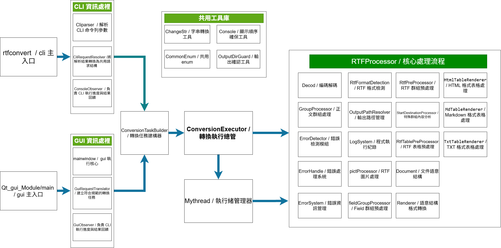
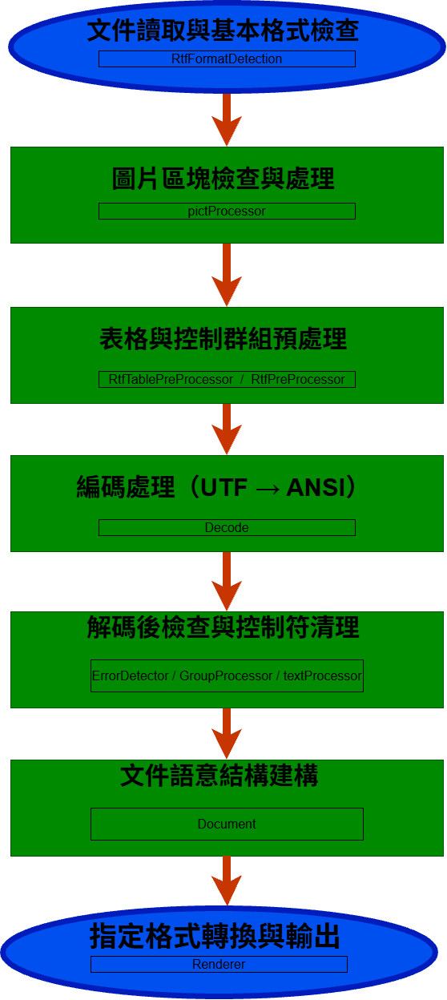
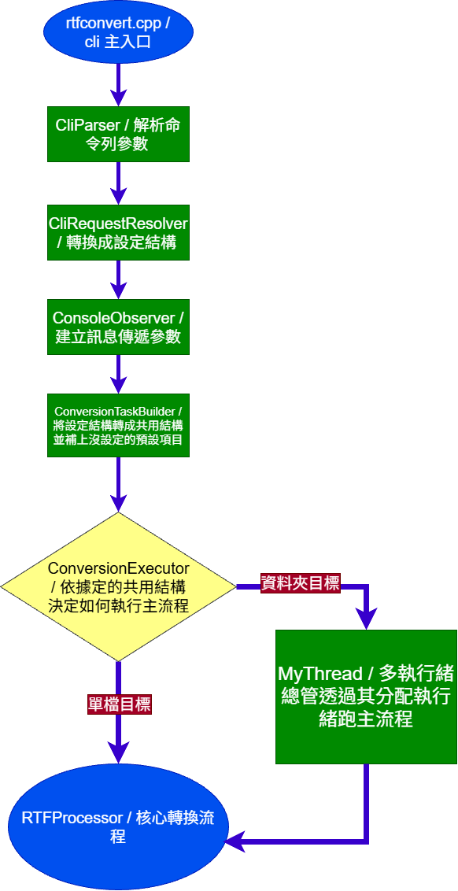
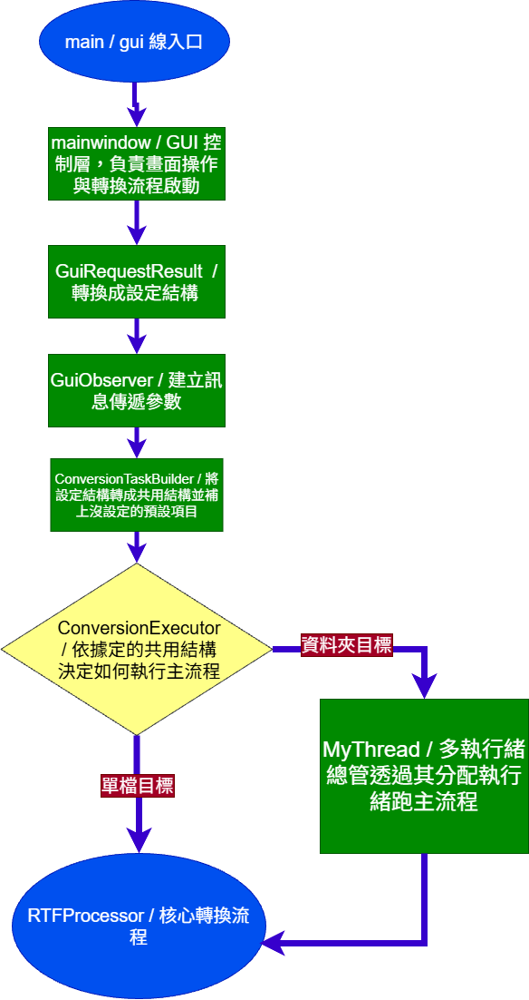
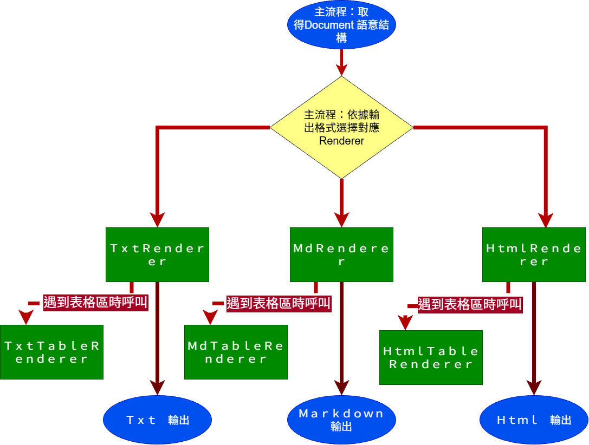

# 開發者手冊 | Developer Manual

## 目錄 | Table of Contents

- [1. 專案介紹 | Project Overview](#1-專案介紹--project-overview)
- [2. 開發環境需求 | Development Environment Requirements](#2-開發環境需求--development-environment-requirements)
- [3. 取得原始碼 | Obtaining the Source Code](#3-取得原始碼--obtaining-the-source-code)
- [4. Windows 11 編譯指南 | Windows 11 Build Guide](#4-windows-11-編譯指南--windows-11-build-guide)
- [5. Ubuntu 24.04 編譯指南 | Ubuntu 24.04 Build Guide](#5-ubuntu-2404-編譯指南--ubuntu-2404-build-guide)
- [6. 專案架構 | Project Architecture](#6-專案架構--project-architecture)
- [7. 測試指南 | Testing Guide](#7-測試指南--testing-guide)
- [8. 開發與維護指南 | Development and Maintenance Guide](#8-開發與維護指南--development-and-maintenance-guide)
- [9. 版本資訊 | Version Information](#9-版本資訊--version-information)

## 1. 專案介紹 | Project Overview

### 1-1 開發目的與設計目標 | Development Purpose and Design Goals

#### 開發背景 | Development Background

本專案的開發起因於原有文件處理工具停止支援，導致既有文件無法透過原有方式正常使用。為解決此問題，遂開始開發一套能夠處理相關文件格式並提供所需轉換功能的工具。

This project was initiated after the discontinuation of support for an existing document processing tool, which made previously used documents inaccessible through the original workflow. To address this issue, a new tool was developed to process the relevant document format and provide the required conversion capabilities.

#### 主要開發目的 | Primary Development Objectives

本專案旨在提供直接且有效率的文件轉換功能，使使用者能夠將目標文件轉換為所需的輸出格式，降低文件處理上的限制。

The primary objective of this project is to provide direct and efficient document conversion capabilities, allowing users to convert target documents into the required output formats while reducing limitations in document processing.

#### 跨平台支援 | Cross-platform Support

本專案以跨平台支援為設計目標，使不同作業系統的使用者皆能透過相應的編譯版本使用本工具，提升程式的可用性與適用範圍。

Cross-platform support is a key design goal of this project. The tool is intended to be available to users across different operating systems through corresponding builds, improving its usability and accessibility.

#### 文件處理 | Document Processing

本專案致力於處理文件中的文字、表格、圖片等不同內容區塊，並依據目標輸出格式的特性，盡可能保留及還原原始文件的內容與結構。

The project aims to process different content elements within documents, including text, tables, and images. Based on the characteristics of each target output format, it seeks to preserve and reconstruct the original document content and structure as accurately as possible.

#### 程式架構 | Software Architecture

本專案採用模組化設計，將不同的處理功能分離為獨立模組，並由主要處理流程依據需求進行呼叫與整合，以提升程式的可維護性、擴展性及功能整合能力。

The project adopts a modular design, separating different processing functionalities into independent modules. These modules are invoked and integrated by the main processing pipeline as required, improving maintainability, extensibility, and functional integration.

### 1-2 專案功能 | Project Features

本專案提供 RTF 文件轉換功能，支援多種輸出格式，並具備文件內容解析、圖片擷取、表格處理及多執行緒轉換等功能。此外，專案提供 CLI 與 GUI 兩種操作介面，並支援 Windows 與 Linux 平台。

This project provides RTF document conversion capabilities with support for multiple output formats. Its core features include document content parsing, image extraction, table processing, and multi-threaded conversion. The project also provides both CLI and GUI interfaces and supports Windows and Linux platforms.

### 1-3 開發技術 | Technologies

本專案主要使用 C++ 作為開發語言，並透過 CMake 管理建置流程。專案使用 GCC 系列編譯器進行編譯，Windows 平台採用 MinGW-w64，GUI 介面則使用 Qt 6 框架。此外，專案使用 iconv 進行字元編碼轉換，並透過 Git 管理原始碼與版本。

This project primarily uses C++ as its programming language and CMake to manage the build process. GCC-based compilers are used for compilation, with MinGW-w64 on the Windows platform. The GUI is developed using the Qt 6 framework. Additionally, iconv is used for character encoding conversion, and Git is used for source code and version control.

|技術/Technology|用途|Description|
|---|---|---|
|C++|主要開發語言|Main programming language|
|CMake|建置系統與跨平台建置管理|Build system and cross-platform build management|
|GCC / MinGW-w64|C++ 編譯器|C++ compiler|
|Qt 6|GUI 介面開發框架|GUI development framework|
|iconv|字元編碼轉換|Character encoding conversion|
|Git|原始碼與版本控制|Source code and version control|

編譯環境資訊 | Build Environment Information

|平台/Platform|編譯器/Compiler|CMake 版本/CMake Version|
|---|---|---|
|Windows 11 Home|GCC (MinGW-w64 13.1.0, Qt MinGW Toolchain)|4.3.0|
|Ubuntu 24.04|GCC 13.3.0 (Ubuntu)|3.28.3|

Windows 平台使用 MinGW Makefiles 作為 CMake Generator，並透過 mingw32-make 進行建置。Ubuntu 平台則使用 Unix Makefiles 作為 CMake Generator，並透過 GNU Make 進行建置。

On Windows, the MinGW Makefiles generator is used with mingw32-make. On Ubuntu, the Unix Makefiles generator is used with GNU Make.

補充說明 | Note: 

Windows CLI 與 GUI 使用不同的 MinGW 編譯器安裝環境。上述 Windows 編譯器版本以 GUI 編譯環境為基準（GCC 13.1.0，Qt MinGW Toolchain）。CLI-only build 則使用 C:/mingw64/bin/c++.exe，該編譯器由 MinGW-Builds project 提供，版本為 GCC 14.2.0。

The Windows CLI and GUI builds use different MinGW compiler installations. The Windows compiler version listed above is based on the GUI build environment (GCC 13.1.0, Qt MinGW Toolchain). The CLI-only build uses C:/mingw64/bin/c++.exe, which is provided by the MinGW-Builds project and uses GCC 14.2.0.

---

## 2. 開發環境需求 | Development Environment Requirements

### 2-1 共通開發需求 | Common Requirements

本專案使用 CMake 管理建置流程，並採用 C++20 標準進行開發。為了從原始碼進行編譯，開發環境需具備 CMake 與支援 C++20 的 C++ 編譯器。此外，若透過 Git 取得專案原始碼，則需安裝 Git。各平台所需的編譯器、建置工具及其他相依套件將於後續平台專屬章節中說明。

This project uses CMake to manage the build process and is developed using the C++20 standard. To build the project from source, the development environment requires CMake and a C++ compiler that supports C++20. Additionally, Git is required when obtaining the project source code through Git. Platform-specific compilers, build tools, and other dependencies are described in the subsequent platform-specific sections.

### 2-2 Windows 11 開發環境 | Windows 11 Development Environment

Windows 平台的開發與編譯需要以下編譯器、建置工具及相關依賴。

Windows development requires the following compilers, build tools, and dependencies.

|工具/Tool|版本/Version|用途|Purpose|
|---|---|---|---|
|Windows 11|Windows 11 Home or compatible edition|開發與編譯環境|Development and build environment|
|GCC / MinGW-w64|GCC 14.2.0|CLI 編譯工具鏈|CLI compilation toolchain|
|CMake|4.4.4|建置系統組態與管理|Build system configuration and management|
|MinGW Make|GNU Make 4.4.1|執行 CMake 建置流程|Executes CMake build process|
|Qt|Qt 6.12.0 MinGW 64-bit|GUI 開發與編譯|GUI development and compilation|
|Qt-compatible MinGW|MinGW 13.1.0 64-bit|與 Qt 相容的 GUI 編譯工具鏈|GUI compilation toolchain compatible with Qt|
|iconv|MSYS2 MinGW-w64 libiconv|字元編碼轉換依賴|Character encoding conversion dependency|
|Git (Optional)|---|原始碼取得與版本管理|Source code retrieval and version control|

補充說明 | Additional Notes：

- CLI 編譯使用 GCC 14.2.0 工具鏈，並需配置對應的 iconv 依賴。
- GUI 編譯需使用 Qt 提供的 MinGW 13.1.0 工具鏈，以確保與所安裝的 Qt 套件相容。
- GUI 建置組態階段需設定 Qt 安裝路徑及對應的 CMake 參數。
- GUI 編譯完成後，需使用 windeployqt 部署必要的 Qt runtime DLL、相關 plugins 與編譯器 runtime。
- Git 為選用工具，亦可直接下載專案原始碼壓縮檔。
- 
- CLI compilation uses the GCC 14.2.0 toolchain and requires the corresponding iconv dependency configuration.
- GUI compilation requires the MinGW 13.1.0 toolchain provided by Qt to ensure compatibility with the installed Qt package.
- Qt installation paths and corresponding CMake parameters must be configured during GUI build configuration.
- After GUI compilation, windeployqt is required to deploy the necessary Qt runtime libraries, plugins, and compiler runtime dependencies.
- Git is optional. The source code can also be obtained by downloading the project archive directly.

### 2-3 Ubuntu 24.04 開發環境 | Ubuntu 24.04 Development Environment

Linux 平台的開發與編譯需要以下編譯器、建置工具及相關依賴。

Linux development requires the following compilers, build tools, and dependencies.

|工具/Tool|版本/Version|用途|Purpose|
|---|---|---|---|
|Ubuntu|Ubuntu 24.04.2 LTS x86_64|開發與編譯環境|Development and build environment|
|GCC / G++|GCC 13.3.0|CLI 與 GUI 編譯工具鏈|CLI and GUI compilation toolchain|
|CMake|3.28.3|建置系統組態與管理|Build system configuration and management|
|GNU Make|GNU Make 4.3|執行 CMake 建置流程|Executes CMake build process|
|Qt|Qt 6.4.2|GUI 開發與編譯|GUI development and compilation|
|iconv|GLIBC 2.39|字元編碼轉換依賴|Character encoding conversion dependency|
|Git (Optional)|---|原始碼取得與版本管理|Source code retrieval and version control|

補充說明 | Additional Notes：

- CLI 與 GUI 編譯使用 Ubuntu 系統提供的 GCC / G++ 工具鏈。
- GUI 編譯需安裝 Qt 6 Base 開發套件，以提供 Qt Widgets 及相關建置依賴。
- Linux 平台使用 Unix Makefiles 作為 CMake 建置產生器。
- iconv 已包含於 Ubuntu 系統的 GLIBC 中，無需額外安裝獨立套件。
- Git 為選用工具，亦可直接下載專案原始碼壓縮檔。
- 
- CLI and GUI compilation use the GCC / G++ toolchain provided by Ubuntu.
- GUI compilation requires the Qt 6 Base development package to provide Qt Widgets and related build dependencies.
- Linux uses Unix Makefiles as the CMake build generator.
- iconv is included in Ubuntu's GLIBC and does not require a separate package installation.
- Git is optional. The source code can also be obtained by downloading the project archive directly. 


### 2-4 版本與相依性說明 | Version and Dependency Information

本專案使用 C++ 開發，並透過 CMake 管理建置流程。CLI 與 GUI 模組依據各自的功能需求使用相關函式庫及開發工具。不同平台的工具版本與安裝需求請參考 Windows 與 Ubuntu 開發環境章節。

This project is developed in C++ and uses CMake to manage the build process. The CLI and GUI modules use libraries and development tools according to their respective requirements. Refer to the Windows and Ubuntu Development Environment sections for platform-specific tool versions and installation requirements.

相依性項目 | Dependency Components : 

|項目/Component|相依性/Dependency|用途/Purpose|
|---|---|---|
|C++ Standard|C++20|提供程式語言標準與功能支援 / Provides language standard and feature support|
|CMake|CMake Build System|專案組態與建置管理 / Project configuration and build management|
|CLI|C++ Standard Library、iconv|命令列程式與字元編碼轉換 / CLI functionality and character encoding conversion|
|GUI|Qt 6 Widgets|圖形使用者介面開發 / Graphical user interface development|
|Compiler Toolchain|GCC / G++、MinGW|C++ 程式編譯 / C++ compilation|

補充說明 | Additional Notes：

- GUI 模組依賴 Qt 6 Widgets，需使用與 Qt 套件相容的編譯工具鏈。
- CLI 與 GUI 的建置需求依平台有所不同，詳細設定請參考各平台編譯指南。

- The GUI module depends on Qt 6 Widgets and requires a compiler toolchain compatible with the Qt package.
- CLI and GUI build requirements differ by platform. Refer to the platform-specific build guides for detailed configuration.

---

## 3. 取得原始碼 | Obtaining the Source Code

### 3-1 Git Repository | Git Repository

本專案原始碼託管於 GitHub，開發者可透過以下 Repository 取得專案原始碼。

The source code of this project is hosted on GitHub. Developers can access the project source code through the following repository.

Repository URL：

https://github.com/suku156/rtf_convert

### 3-2 Clone 專案 | Cloning the Repository

開發者可使用 Git Clone 指令，將 GitHub Repository 中的專案原始碼複製至本機環境。

Developers can use the Git Clone command to copy the project source code from the GitHub Repository to their local environment.

在終端機中執行以下指令：

Execute the following command in the terminal:

```bash
git clone https://github.com/suku156/rtf_convert.git
```
Clone 完成後，進入專案目錄：

After cloning is complete, navigate to the project directory:

```bash
cd ./rtf_convert
```

### 3-3 專案目錄結構 | Project Directory Structure

本專案主要由 CMake 建置配置檔、程式入口檔及原始碼目錄組成。以下列出專案根目錄中的主要檔案與目錄。

The project primarily consists of CMake build configuration files, an application entry point, and a source code directory. The following table lists the main files and directories in the project root.

|目錄／檔案|Directory / File|用途|Purpose|
|---|---|---|---|
|CMakeLists.txt|CMake Build Configuration|定義專案建置配置、編譯選項及相關依賴。|Defines project build configuration, compilation options, and dependencies.|
|CMakePresets.json|CMake Presets Configuration|預先定義不同平台及建置模式的 CMake 配置。|Defines predefined CMake configurations for different platforms and build modes.|
|rtfconvert.cpp|Application Entry Point|專案主要程式入口檔。|Main application entry point.|
|src|Source Directory|存放專案主要原始碼及相關模組。|Contains the main source code and related modules.|

---

## 4. Windows 11 編譯指南 | Windows 11 Build Guide

### 4-1 編譯環境配置 | Build Environment Setup

在編譯專案之前，需先於 Windows 環境中安裝並配置必要的開發工具與相關依賴。

Before compiling the project, the required development tools and dependencies must be installed and configured on the Windows environment.

#### 4-1-1 CMake 安裝 | CMake Installation

可透過 Windows 套件管理工具（winget）於 PowerShell 中安裝 CMake。

CMake can be installed using the Windows Package Manager (winget) through PowerShell.

安裝指令 | Installation :

```bash
winget install Kitware.CMake
```

安裝完成後，可使用以下指令確認 CMake 是否已正確安裝。

After installation, verify the installed version using the following command.

```bash
cmake --version
```
執行後應顯示已安裝的 CMake 版本資訊。

The installed CMake version should be displayed in the command-line output.

#### 4-1-2 GCC / MinGW 安裝 | GCC / MinGW Installation

本專案 CLI 編譯使用 GCC 搭配 MinGW-w64 工具鏈，實測使用的編譯器版本為 GCC 14.2.0。

The project uses GCC with the MinGW-w64 toolchain for CLI compilation. The tested compiler version is GCC 14.2.0.

實測工具鏈版本　| Tested Toolchain Version:

- GCC Version：14.2.0
- Architecture：x86_64
- Thread Model：POSIX
- Exception Model：SEH
- Runtime：UCRT

下載來源 | Download Source:

本次實測使用的 MinGW-w64 工具鏈可由以下 GitHub Release 取得。

The tested MinGW-w64 toolchain can be obtained from the following GitHub release.

- GitHub Release: https://github.com/niXman/mingw-builds-binaries/releases/tag/14.2.0-rt_v12-rev0

- Archive File: x86_64-14.2.0-release-posix-seh-ucrt-rt_v12-rev0.7z

安裝方式 | Installation:

下載對應的 MinGW-w64 GCC 工具鏈壓縮檔，並解壓縮至以下目錄。

Download the corresponding MinGW-w64 GCC toolchain archive and extract it to the following directory.

```bash
C:\mingw64
```

環境變數配置 | Environment Variable Configuration:

將以下目錄加入使用者或系統的 PATH 環境變數。

Add the following directory to the user or system PATH environment variable.

```bash
C:\mingw64\bin
```
版本驗證 | Version Verification:

```bash
gcc --version
g++ --version
mingw32-make --version
```
本次實測使用 GCC 14.2.0。其他 GCC 版本亦可嘗試使用，但需確保工具鏈及相關依賴與專案相容。

The tested GCC version is 14.2.0. Other GCC versions may be used, provided that the toolchain and its dependencies are compatible with the project.

#### 4-1-3 iconv 依賴配置 | iconv Dependency Configuration

CLI 版本需要使用 iconv 函式庫進行字元編碼轉換。本次透過 MSYS2 MinGW-w64 環境取得相關檔案，並移植至獨立的 MinGW-w64 工具鏈。

The CLI version requires the iconv library for character encoding conversion. The required files are obtained from the MSYS2 MinGW-w64 environment and transferred to the standalone MinGW-w64 toolchain.

下載來源 | Download Source:

iconv 套件可由 MSYS2 官方套件庫取得。

The iconv package can be obtained from the official MSYS2 package repository.

- MSYS2 Package: https://packages.msys2.org/packages/mingw-w64-x86_64-libiconv

檔案移植 | File Transfer:

將以下檔案由 MSYS2 MinGW-w64 環境複製至獨立 MinGW-w64 工具鏈的對應目錄。

Copy the following files from the MSYS2 MinGW-w64 environment to the corresponding directories of the standalone MinGW-w64 toolchain.

|檔案/File|MSYS2 壓縮檔解壓縮位置|MSYS2 Archive Extraction Path|目標位置/Target location|
|---|---|---|---|
|iconv.h|<MSYS2 解壓縮目錄>\mingw64\include\iconv.h|<MSYS2 Archive Extraction Path>\mingw64\include\iconv.h|C:\mingw64\include\iconv.h|
|libiconv.a|<MSYS2 解壓縮目錄>\mingw64\lib\libiconv.a|<MSYS2 Archive Extraction Path>\mingw64\lib\libiconv.a|C:\mingw64\lib\libiconv.a|
|libiconv.dll.a|<MSYS2 解壓縮目錄>\mingw64\lib\libiconv.dll.a|<MSYS2 Archive Extraction Path>\mingw64\lib\libiconv.dll.a|C:\mingw64\lib\libiconv.dll.a|
|libiconv-2.dll|<MSYS2 解壓縮目錄>\mingw64\bin\libiconv-2.dll|<MSYS2 Archive Extraction Path>\mingw64\bin\libiconv-2.dll|C:\mingw64\bin\libiconv-2.dll|

以上路徑皆以 MinGW-w64 工具鏈的根目錄為基準。若 MinGW 安裝於不同磁碟或資料夾，請依實際位置調整。

The paths below are relative to the MinGW-w64 toolchain root directory. If MinGW is installed on a different drive or in another directory, adjust the paths accordingly.

例如，若 MinGW 根目錄為 D:\mingw64，則 iconv.h 應放置於 D:\mingw64\include\iconv.h。

連結方式說明 | Linking Configuration：

本專案使用 libiconv.a 進行靜態連結，使所需的 iconv 實作被包含於編譯產生的執行檔中，避免執行時依賴 libiconv-2.dll。

libiconv.dll.a 匯入函式庫與 libiconv-2.dll 亦保留於移植的依賴檔案中，但目前專案採用的靜態連結配置並不需要依賴這兩個檔案。

The project uses the static library libiconv.a for linking. This allows the required iconv implementation to be included in the compiled executable, avoiding a runtime dependency on libiconv-2.dll.

The libiconv.dll.a import library and libiconv-2.dll are retained as part of the transferred dependency files, but are not required for the project's current static linking configuration.

#### 4-1-4 Qt 開發環境安裝 | Qt Development Environment Installation

前往 Qt 官方下載頁面，下載並執行 Qt Online Installer，依照安裝程式的指示完成 Qt 開發環境配置。

Visit the official Qt download page, download and run the Qt Online Installer, and follow the installation instructions to configure the Qt development environment.

- 官方下載頁面 | Official Download Page: https://www.qt.io/development/download-qt-installer-oss
- 參考版本 | Reference Version：Qt 6.12.0 MinGW 64-bit
- 配套編譯器 | Corresponding Compiler：Qt MinGW 13.1.0 64-bit

注意 | Note：

GUI 編譯所使用的 Qt 套件與 MinGW 編譯器需保持相容。建議使用 Qt 安裝程式所提供的配套 MinGW 工具鏈，並以本專案已驗證的版本作為參考。

The Qt package and MinGW compiler used for GUI builds must be compatible. It is recommended to use the corresponding MinGW toolchain provided by the Qt installer, with the versions verified by this project as a reference.

#### 4-1-5 環境配置驗證 | Environment Verification

完成上述環境安裝後，開啟 PowerShell，依序執行以下指令，確認相關工具已正確安裝並可正常使用。

After completing the environment setup, open PowerShell and execute the following commands to verify that the required tools are installed and accessible.

|工具/Tool|驗證指令/command|
|---|---|
|CMake|cmake --version|
|GCC|gcc --version|
|G++|g++ --version|
|MinGW Make|mingw32-make --version|

若各指令皆能正常輸出版本資訊，則表示基本編譯環境已完成配置。

If all commands display their version information successfully, the basic build environment is configured.

### 4-2 CMake Presets 配置 | CMake Presets Configuration

本專案透過 CMakePresets.json 預先定義 Windows 平台的建置配置，提供 CLI、GUI 與 Sandbox 三種建置模式。開發者可使用對應的 Configure Preset 與 Build Preset，完成專案配置及編譯。

This project uses CMakePresets.json to define predefined build configurations for Windows, providing three build modes: CLI, GUI, and Sandbox. Developers can use the corresponding Configure Presets and Build Presets to configure and build the project.

Preset 配置項目 | Preset Configuration Options

|Configure Preset|Build Preset|建置模式|Build Mode|
|---|---|---|---|
|cli|build-cli|命令列介面|Command-Line Interface|
|gui|build-gui|圖形使用者介面|Graphical User Interface|
|sandbox|build-sandbox|沙盒測試環境|Sandbox Testing Environment|

注意事項 | Notes :

GUI Preset 中已預先設定 Qt 開發環境與 MinGW 編譯器的路徑。若實際安裝位置與 Preset 中所設定的路徑不同，請於使用前修改 CMakePresets.json 中的 CMAKE_PREFIX_PATH、CMAKE_C_COMPILER 與 CMAKE_CXX_COMPILER，使其符合目前的開發環境。

The GUI Preset contains predefined paths for the Qt development environment and MinGW compiler. If the actual installation locations differ from those specified in the preset, modify CMAKE_PREFIX_PATH, CMAKE_C_COMPILER, and CMAKE_CXX_COMPILER in CMakePresets.json before use to match the local development environment.

### 4-3 CLI 編譯流程 | CLI Build Procedure

本節介紹 Windows 平台下 CLI 程式的編譯方式，包含使用專案提供的 CMake Presets，以及手動指定 CMake 配置參數兩種方式。

This section describes how to build the CLI application on Windows using either the CMake Presets provided by the project or manually specified CMake configuration parameters.

#### 4-3-1 使用 CMake Presets 編譯 | Build Using CMake Presets

在專案根目錄開啟 PowerShell，依序執行以下指令：

Open PowerShell in the project root directory and execute the following commands:

1. 配置專案 | Configure the Project

```bash
cmake --preset cli
```

2. 編譯專案 | Build the Project

```bash
cmake --build --preset build-cli
```

完成編譯後，CLI 執行檔將生成於對應的建置目錄中。

After the build completes, the CLI executable will be generated in the corresponding build directory.

注意事項 | Notes :

CLI Preset 需要系統能透過 PATH 找到相容的 MinGW 工具鏈。若 MinGW 安裝於自訂目錄，請先將其 bin 目錄加入 PATH，再進行專案配置。

CLI Preset requires a compatible MinGW toolchain to be available through the system PATH. If MinGW is installed in a custom directory, ensure its bin directory is added to PATH before configuring the project.

#### 4-3-2 手動配置與編譯 | Manual Configuration and Build

若不使用專案提供的 CMakePresets.json，開發者可透過手動指定 CMake 配置參數，完成 CLI 程式的配置與編譯。

If the provided CMakePresets.json is not used, developers can manually specify the CMake configuration parameters to configure and build the CLI application.

1. 配置專案 | Configure the Project

在專案根目錄開啟 PowerShell，執行以下指令：

Open PowerShell in the project root directory and execute the following command:

```bash
cmake -S . -B build-windows-cli `
  -G "MinGW Makefiles" `
  -DCMAKE_C_COMPILER="C:\mingw64\bin\gcc.exe" `
  -DCMAKE_CXX_COMPILER="C:\mingw64\bin\g++.exe" `
  -DBUILD_CLI=ON `
  -DBUILD_GUI=OFF `
  -DBUILD_SANDBOX=OFF
```

2. 編譯專案 | Build the Project

配置完成後，執行以下指令進行編譯：

After configuration completes, execute the following command to build the project:

```bash
cmake --build build-windows-cli
```
完成編譯後，CLI 執行檔將生成於建置目錄中。

After the build completes, the CLI executable will be generated in the build directory.

注意事項 | Notes :

以上 GCC / G++ 編譯器路徑為範例，請依照 MinGW-w64 工具鏈的實際安裝位置進行調整。

The GCC / G++ compiler paths shown below are examples. Please adjust them according to the actual installation location of the MinGW-w64 toolchain.

### 4-4 GUI 編譯流程 | GUI Build Procedure

#### 4-4-1 使用 CMake Presets 編譯 | Build Using CMake Presets

GUI 專案可透過 CMakePresets.json 中定義的 GUI Preset 進行配置與編譯。在執行編譯前，請確認 Preset 中的 Qt 安裝路徑與 MinGW 編譯器路徑符合目前的環境配置。

The GUI project can be configured and built using the GUI Preset defined in CMakePresets.json. Before building, ensure that the Qt installation path and MinGW compiler path in the preset match the current environment.

編譯指令 | Build Commands : 

```bash
cmake --preset gui
cmake --build --preset build-gui
```
注意事項 | Notes :

- 請開啟專案根目錄中的 CMakePresets.json，找到 configurePresets 陣列內的 gui Preset，並於其 cacheVariables 區段調整以下設定：
  - CMAKE_PREFIX_PATH：設定為 Qt MinGW 64-bit 的安裝路徑，例如 C:/Qt/6.12.0/mingw_64。
  - CMAKE_CXX_COMPILER：設定為與 Qt 相容的 MinGW g++.exe 完整路徑，例如 C:/Qt/Tools/mingw1310_64/bin/g++.exe。

- Please open CMakePresets.json in the project root directory. Locate the gui preset within the configurePresets array and adjust the following settings under its cacheVariables section:
  - CMAKE_PREFIX_PATH: Set this to the Qt MinGW 64-bit installation path, e.g., C:/Qt/6.12.0/mingw_64.
  - CMAKE_CXX_COMPILER: Set this to the full path of the compatible MinGW g++.exe, e.g., C:/Qt/Tools/mingw1310_64/bin/g++.exe.

- GUI 編譯完成後，仍需進行 Qt 執行環境部署，才能確保程式於未安裝 Qt 開發環境的 Windows 系統上正常執行。

- After building the GUI, Qt runtime deployment is still required to ensure the application can run on Windows systems without the Qt development environment installed.

#### 4-4-2 手動配置與編譯 | Manual Configuration and Build

若未使用 CMakePresets.json，亦可透過手動指定 CMake 配置參數進行 GUI 專案的配置與編譯。

If CMakePresets.json is not used, the GUI project can also be configured and built by manually specifying the CMake configuration parameters.

配置指令 | Configuration Command :

```bash
cmake -S . -B build-windows-gui `
  -G "MinGW Makefiles" `
  -DCMAKE_PREFIX_PATH="C:\Qt\6.12.0\mingw_64" `
  -DQt6_DIR="C:\Qt\6.12.0\mingw_64\lib\cmake\Qt6" `
  -DCMAKE_CXX_COMPILER="C:\Qt\Tools\mingw1310_64\bin\g++.exe" `
  -DCMAKE_MAKE_PROGRAM="C:\Qt\Tools\mingw1310_64\bin\mingw32-make.exe" `
  -DBUILD_CLI=ON `
  -DBUILD_GUI=OFF `
  -DBUILD_SANDBOX=OFF
```
編譯指令 | Build Command :

```bash
cmake --build build-windows-gui
```
注意事項 | Notes

- 請依照實際安裝的 Qt 版本與 MinGW 路徑調整上述配置參數。
- GUI 編譯需要安裝 Qt 開發環境及相容的 MinGW 工具鏈。
- 編譯完成後，仍需進行 Qt 執行環境部署。

- Adjust the configuration parameters according to the installed Qt version and MinGW paths.
- GUI compilation requires the Qt development environment and a compatible MinGW toolchain.
- Qt runtime deployment is still required after compilation.

#### 4-4-3 Qt 執行環境部署 | Qt Runtime Deployment

GUI 專案編譯完成後，需使用 Qt 提供的 windeployqt 工具，將應用程式所需的 Qt 執行依賴部署至輸出目錄，以確保程式能在未安裝 Qt 開發環境的 Windows 系統上執行。

After the GUI project has been compiled, the Qt windeployqt tool is used to deploy the required Qt runtime dependencies to the output directory, allowing the application to run on Windows systems without the Qt development environment installed.

部署指令 | Deployment Command

```bash
& "C:\Qt\6.12.0\mingw_64\bin\windeployqt.exe" `
  --compiler-runtime `
  "C:\windows-build-test\rtf_convert-master\build-windows-gui\bin\rtfconvert_gui.exe"
```
指令說明 | Command Description

- Source（來源）：C:\Qt\6.12.0\mingw_64\bin\windeployqt.exe，Qt 提供的執行環境部署工具 , 請依據實際安裝位置調整。
- Target（目標）: C:\windows-build-test\rtf_convert-master\build-windows-gui\bin\rtfconvert_gui.exe，需要進行執行環境部署的 GUI 執行檔,請依據實際位置調整。
- --compiler-runtime：部署所需的編譯器執行階段依賴。

- Source: C:\Qt\6.12.0\mingw_64\bin\windeployqt.exe, the Qt runtime deployment tool. Please adjust the path according to your actual installation location.
- Target: C:\windows-build-test\rtf_convert-master\build-windows-gui\bin\rtfconvert_gui.exe, the GUI executable to be deployed. Please adjust the path according to its actual location.
- --compiler-runtime: Deploys the required compiler runtime dependencies.

部署驗證 | Deployment Verification

部署完成後，請確認 GUI 執行檔能於 Windows 11 環境中正常啟動，並執行相關功能測試。

After deployment, verify that the GUI executable launches successfully and performs the required functional tests in the Windows 11 environment.

### 4-5 編譯結果驗證 | Build Verification

確認 CLI 與 GUI 執行檔皆能正常建立及啟動。

Verify that both the CLI and GUI executables are successfully built and can launch correctly.

### 4-6 常見編譯問題 | Common Build Issues

本節整理 Windows 11 編譯過程中可能遇到的常見問題、錯誤現象及其解決方式。

This section summarizes common issues that may occur during the Windows 11 build process, along with their symptoms and solutions.

#### 4-6-1  CMake 無法找到 Qt 安裝路徑 | CMake Cannot Find the Qt Installation Path

問題現象 | Symptom

CMake 配置過程中出現以下錯誤：

The following error occurs during CMake configuration:

```bash
Could not find a package configuration file provided by "Qt6"
with any of the following names:
  Qt6Config.cmake
  qt6-config.cmake
```
可能原因 | Possible Cause

CMAKE_PREFIX_PATH 未正確設定，或指定的 Qt 安裝路徑不存在。

The CMAKE_PREFIX_PATH variable is not configured correctly, or the specified Qt installation path does not exist.

解決方式 | Solution

請確認 CMakePresets.json 中 gui Preset 的 cacheVariables 區段，並將 CMAKE_PREFIX_PATH 設定為正確的 Qt MinGW 64-bit 安裝路徑，例如：

Check the cacheVariables section of the gui preset in CMakePresets.json and set CMAKE_PREFIX_PATH to the correct Qt MinGW 64-bit installation path, for example:

```bash
"CMAKE_PREFIX_PATH": "C:/Qt/6.12.0/mingw_64"
```
#### 4-6-2 Qt 與 MinGW 編譯器版本不相容 | Qt and MinGW Compiler Version Incompatibility

問題現象 | Symptom

CMake 配置或編譯過程中出現編譯器不相容、ABI 不相容或相關工具鏈錯誤。

CMake configuration or compilation fails due to compiler incompatibility, ABI incompatibility, or related toolchain errors.

可能原因 | Possible Cause

使用的 MinGW 編譯器與 Qt 安裝版本所配套的 MinGW 工具鏈不一致。

The MinGW compiler being used does not match the toolchain associated with the installed Qt version.

例如，Qt 6.12.0 MinGW 64-bit 使用配套的 MinGW 13.1.0，但系統 PATH 中優先使用另一個 MinGW 版本。

For example, Qt 6.12.0 MinGW 64-bit is paired with MinGW 13.1.0, but another MinGW version is selected through the system PATH.

解決方式 | Solution

請確認 CMAKE_CXX_COMPILER 指向與 Qt 相容的 MinGW g++.exe，例如：

Ensure that CMAKE_CXX_COMPILER points to the MinGW g++.exe compatible with Qt, for example:

```bash
"CMAKE_CXX_COMPILER": "C:/Qt/Tools/mingw1310_64/bin/g++.exe"
```

同時確認 CMAKE_MAKE_PROGRAM 使用相同工具鏈中的 mingw32-make.exe。

Also ensure that CMAKE_MAKE_PROGRAM uses the mingw32-make.exe from the same toolchain.

#### 4-6-3 CMakePresets.json 路徑配置錯誤 | Incorrect Path Configuration in CMakePresets.json

問題現象 | Symptom

執行 cmake --preset gui 時，出現找不到編譯器或指定路徑不存在的錯誤。

When running cmake --preset gui, an error occurs indicating that the compiler cannot be found or the specified path does not exist.

```bash
The CMAKE_CXX_COMPILER:

  C:/Qt/Tools/mingw1310_64/bin/g++.exe

is not a full path to an existing compiler tool.
```
可能原因 | Possible Cause

CMakePresets.json 中設定的 Qt 或 MinGW 路徑與實際安裝位置不一致，例如版本資料夾名稱錯誤或路徑拼寫錯誤。

The Qt or MinGW paths specified in CMakePresets.json do not match the actual installation locations, such as an incorrect version directory or a path typo.

解決方式 | Solution

請確認 CMakePresets.json 中 gui Preset 的 cacheVariables 區段，並依照實際安裝位置修正相關路徑。

Check the cacheVariables section of the gui preset in CMakePresets.json and correct the paths according to the actual installation locations.

若先前已進行配置，且修正路徑後仍出現錯誤，可移除原本的 build_gui 配置目錄，再重新執行：

If the project was previously configured and errors persist after correcting the paths, remove the existing build_gui directory and run the following commands again:

```bash
cmake --preset gui
cmake --build --preset build-gui
```
#### 4-6-4 GUI 編譯完成但缺少 Qt 執行依賴 | Missing Qt Runtime Dependencies After GUI Compilation

問題現象 | Symptom

GUI 執行檔已成功編譯，但啟動時出現缺少 DLL 的錯誤，例如：

The GUI executable has been successfully built, but an error occurs during startup indicating that a required DLL is missing, for example:

```bash
The code execution cannot proceed because Qt6Widgets.dll
was not found.
```
也可能出現 Qt Platform Plugin 無法載入的錯誤。

An error may also occur indicating that the Qt Platform Plugin cannot be loaded.

可能原因 | Possible Cause

GUI 編譯完成後，尚未將 Qt 執行所需的 DLL 與 Plugins 部署至執行檔所在目錄。

The required Qt runtime DLLs and Plugins have not yet been deployed to the executable's directory after compilation.

解決方式 | Solution

請使用 Qt 提供的 windeployqt 工具，對 GUI 執行檔進行執行環境部署。

Use the Qt windeployqt tool to deploy the runtime environment for the GUI executable.

```bash
& "C:\Qt\6.12.0\mingw_64\bin\windeployqt.exe" `
  --compiler-runtime `
  "C:\windows-build-test\rtf_convert-master\build-windows-gui\bin\rtfconvert_gui.exe"
```
請依照實際 Qt 安裝位置與 GUI 執行檔位置調整指令中的路徑。

Adjust the paths in the command according to the actual Qt installation location and GUI executable location.

部署完成後，重新啟動 GUI 執行檔並確認程式能正常運作。

After deployment, launch the GUI executable again and verify that the application runs correctly.

---

## 5. Ubuntu 24.04 編譯指南 | Ubuntu 24.04 Build Guide

### 5-1 編譯環境配置 | Build Environment Setup

Ubuntu 編譯環境需安裝基本建置工具、CMake 及 Qt 開發套件，以支援 CLI 與 GUI 的編譯流程。

The Ubuntu build environment requires basic build tools, CMake, and Qt development packages to support CLI and GUI compilation.

安裝必要套件 | Install Required Packages

使用以下指令更新套件清單並安裝所需的編譯工具及 Qt 開發套件。

Use the following commands to update the package list and install the required build tools and Qt development packages.

```bash
sudo apt update
sudo apt install build-essential cmake qt6-base-dev
```

套件用途 | Package Description：

|套件/Package|用途/Purpose|
|---|---|
|build-essential|安裝 GCC、G++、GNU Make 等基本編譯工具 / Installs basic compilation tools including GCC, G++, and GNU Make.|
|cmake|提供專案建置系統組態與管理工具 / Provides project build configuration and management.|
|qt6-base-dev|提供 Qt 6 Base 開發檔案及 GUI 建置所需依賴 / Provides Qt 6 Base development files and GUI build dependencies.|

環境確認 | Environment Verification

安裝完成後，可使用以下指令確認相關工具是否已正確安裝。

After installation, use the following commands to verify that the required tools are installed.

```bash
cmake --version
gcc --version
g++ --version
make --version
qmake6 --version
```

補充說明 | Additional Notes：

- Ubuntu 原始環境已包含 iconv，無需額外安裝獨立套件。
- CLI 與 GUI 建置均使用 Ubuntu 系統提供的編譯工具鏈。
- Git 為選用工具，可透過 Git 或直接下載原始碼壓縮檔取得專案。

- The original Ubuntu environment already includes iconv; no separate package installation is required.
- Both CLI and GUI builds use the compilation toolchain provided by Ubuntu.
- Git is optional. The source code can be obtained through Git or by downloading the project archive directly.

### 5-2 CMake Presets 配置 | CMake Presets Configuration

本專案透過 CMakePresets.json 預先定義 Ubuntu 平台的建置配置，提供 CLI 與 GUI 兩種建置模式。開發者可使用對應的 Configure Preset 與 Build Preset，完成專案配置及編譯。

This project uses CMakePresets.json to define predefined build configurations for Ubuntu, providing two build modes: CLI and GUI. Developers can use the corresponding Configure Presets and Build Presets to configure and build the project.

Preset 配置項目 | Preset Configuration Options :

|Configure Preset|Build Preset|建置模式|Build Mode|
|---|---|---|---|
|linux-cli|build-linux-cli|命令列介面|Command-Line Interface|
|linux-gui|build-linux-gui|圖形使用者介面|Graphical User Interface|

注意事項 | Notes :

Linux Preset 使用 Unix Makefiles 作為 CMake Generator，並預先設定對應的建置目錄及編譯選項。GUI Preset 使用 Ubuntu 系統所安裝的 Qt 開發環境，不需額外指定 Qt 或編譯器的安裝路徑。

The Linux Presets use Unix Makefiles as the CMake Generator and define the corresponding build directories and compilation options in advance. The GUI Preset uses the Qt development environment installed on Ubuntu, without requiring additional Qt or compiler installation paths to be specified.

### 5-3 CLI 編譯流程 | CLI Build Procedure

本節介紹 Ubuntu 平台下 CLI 程式的編譯方式，包含使用專案提供的 CMake Presets，以及手動指定 CMake 配置參數兩種方式。

This section describes how to build the CLI application on Ubuntu using either the CMake Presets provided by the project or manually specified CMake configuration parameters.

#### 5-3-1 使用 CMake Presets 編譯 | Build Using CMake Presets

在專案根目錄開啟終端機，依序執行以下指令：

Open a terminal in the project root directory and execute the following commands:

配置專案 | Configure the Project :

```bash
cmake --preset linux-cli
```
編譯專案 | Build the Project :

```bash
cmake --build --preset build-linux-cli
```
完成編譯後，CLI 執行檔將生成於對應的建置目錄中。

After the build completes, the CLI executable will be generated in the corresponding build directory.

#### 5-3-2 手動配置與編譯 | Manual Configuration and Build

若不使用專案提供的 CMakePresets.json，開發者可透過手動指定 CMake 配置參數，完成 CLI 程式的配置與編譯。

If the provided CMakePresets.json is not used, developers can manually specify the CMake configuration parameters to configure and build the CLI application.

配置專案 | Configure the Project :

在專案根目錄開啟終端機，執行以下指令：

Open a terminal in the project root directory and execute the following command:

```bash
cmake -S . -B build-linux-cli \
  -DBUILD_CLI=ON \
  -DBUILD_GUI=OFF \
  -DBUILD_SANDBOX=OFF
```
編譯專案 | Build the Project :

配置完成後，執行以下指令進行編譯：

After configuration completes, execute the following command to build the project:

```bash
cmake --build build-linux-cli
```
完成編譯後，CLI 執行檔將生成於建置目錄中。

After the build completes, the CLI executable will be generated in the build directory.

### 5-4 GUI 編譯流程 | GUI Build Procedure

本節介紹 Ubuntu 平台下 GUI 程式的編譯方式，包含使用專案提供的 CMake Presets，以及手動指定 CMake 配置參數兩種方式。

This section describes how to build the GUI application on Ubuntu using either the CMake Presets provided by the project or manually specified CMake configuration parameters.

#### 5-4-1 使用 CMake Presets 編譯 | Build Using CMake Presets

GUI 專案可透過 CMakePresets.json 中定義的 Linux GUI Preset 進行配置與編譯。在執行編譯前，請確認 Ubuntu 系統已安裝 Qt 開發套件及相關建置依賴。

The GUI project can be configured and built using the Linux GUI Preset defined in CMakePresets.json. Before building, ensure that the Qt development packages and related build dependencies are installed on Ubuntu.

配置專案 | Configure the Project :

在專案根目錄開啟終端機，執行以下指令：

Open a terminal in the project root directory and execute the following command:

```bash
cmake --preset linux-gui
```
編譯專案 | Build the Project :

配置完成後，執行以下指令進行編譯：

After configuration completes, execute the following command to build the project:

```bash
cmake --build --preset build-linux-gui
```
注意事項 | Notes :

- Linux GUI Preset 使用 Ubuntu 系統安裝的 Qt 開發環境與 GCC／G++ 編譯工具鏈，無需額外指定 Qt 或編譯器的安裝路徑。
- GUI 編譯前需確認已安裝 qt6-base-dev 套件。

- The Linux GUI Preset uses the Qt development environment and GCC / G++ toolchain installed on Ubuntu, without requiring additional Qt or compiler installation paths.
- Ensure that the qt6-base-dev package is installed before building the GUI.

#### 5-4-2 手動配置與編譯 | Manual Configuration and Build

若未使用 CMakePresets.json，亦可透過手動指定 CMake 配置參數進行 GUI 專案的配置與編譯。

If CMakePresets.json is not used, the GUI project can also be configured and built by manually specifying the CMake configuration parameters.

配置指令 | Configuration Command :

```bash
cmake -S . -B build-linux-gui-manual \
  -DBUILD_CLI=OFF \
  -DBUILD_GUI=ON \
  -DBUILD_SANDBOX=OFF
```
編譯指令 | Build Command :

```bash
cmake --build build-linux-gui-manual
```

注意事項 | Notes :

- GUI 編譯需要安裝 Qt 開發環境及相關依賴套件。
- Linux 平台使用系統預設的 GCC／G++ 編譯器及 Unix Makefiles 建置流程。
- 編譯完成後，程式執行仍需具備相應的 Qt Runtime Libraries。

- GUI compilation requires the Qt development environment and related dependency packages.
- Linux uses the system-default GCC / G++ compiler and the Unix Makefiles build process.
- After compilation, the application still requires the corresponding Qt Runtime Libraries to execute.

### 5-5 編譯結果驗證 | Build Verification

完成 CLI 與 GUI 編譯後，確認所生成的執行檔能正常啟動。

After building the CLI and GUI applications, verify that the generated executables can launch successfully.

### 5-6 常見編譯問題 | Common Build Issues

缺少建置工具或 Qt 開發套件 | Missing Build Tools or Qt Development Packages

若 CMake 無法找到編譯器、Make 或 Qt 相關依賴，請確認已安裝必要的建置套件。

If CMake cannot locate the compiler, Make, or Qt-related dependencies, ensure that the required build packages are installed.

```bash
sudo apt update
sudo apt install build-essential cmake qt6-base-dev
```

---

## 6. 專案架構 | Project Architecture

### 6-1 整體架構 | Overall Architecture

本專案採用模組化架構，主要分為 CLI、GUI、共用工具庫、轉換執行管理與 RTF 核心處理流程。各模組依其職責進行分工，並透過明確的執行流程完成文件轉換。

This project adopts a modular architecture consisting of CLI, GUI, shared utilities, conversion execution management, and the RTF core processing pipeline. Each module is responsible for specific tasks and works together through a defined execution flow to complete document conversion.



### 6-2 核心處理流程 | Core Processing Pipeline

本流程圖呈現 RTF 文件從讀取與基本格式檢查、圖片及表格預處理、編碼處理、控制符清理，到文件語意結構建構與指定格式輸出的主要處理階段。

The flowchart illustrates the main processing stages of an RTF document, from file reading and basic format validation, image and table preprocessing, encoding processing, and control symbol cleanup, to document semantic structure construction and output in the specified format.



### 6-3 核心模組 | Core Modules

#### 6-3-1 RTF 格式解析與前處理 | RTF Parsing and Preprocessing

此分類主要負責 RTF 文件的格式辨識與前處理，透過不同模組處理 RTF 群組結構、起始 Destination、Field 群組及表格相關內容，為後續的文字處理與文件語意結構建立提供基礎。

|模組名稱/Module|主要檔案/Primary File|職責說明|Responsibilities|
|---|---|---|---|
|FormatDetection_Module|RtfFormatDetection|負責辨識輸入文件是否符合 RTF 格式。|Identifies whether the input file conforms to the RTF format.|
|RtfGroupProcessor_Module|RtfPreProcessor|負責 RTF 群組的前處理，整理文件中的群組與控制資訊。|Performs preprocessing of RTF groups and organizes group structures and control information within the document.|
|RtfGroupProcessor_Module|StartDestinationProcessor|專門處理由其他流程找到的 {\\* 開頭之特殊群組，負責判斷與分析群組內容，不負責該群組的結構辨識。|Specifically handles special groups beginning with {\\* that have been identified by other processing stages. It is responsible for evaluating and analyzing the group content, but does not perform structural identification of these groups.|
|RtfGroupProcessor_Module|FieldGroupProcessor|負責處理 RTF Field 群組，整理相關欄位內容。|Processes RTF Field groups and organizes their associated field content.|
|RtfTableProcessor_Module|RtfTablePreProcessor|負責 RTF 表格內容的前處理，為後續表格解析提供基礎。|Performs preprocessing of RTF table content to provide a foundation for subsequent table parsing.|

補充說明 | Note :

- RtfTablePreProcessor : 
  - RTF 表格內容包含多種與列、儲存格及表格配置相關的控制資訊。為避免這些資訊在一般 RTF 群組處理過程中遭到不適當地移除，或干擾後續內容解析，本模組負責將表格所需的相關控制符轉換為對應的標記符，以避免資訊遺失。
  - RTF table content contains various control words related to rows, cells, and table layout. To prevent these control words from being improperly removed during general RTF group processing or from interfering with subsequent content parsing, this module converts the relevant table control words into corresponding markers to prevent information loss.

- RtfPreProcessor :
  - 本模組於解碼前，預先處理可能影響後續解析的 RTF 群組。當找到特定控制群組時，會依據預先定義的處理名單與控制群組名稱進行判斷。若該群組具有專門對應的處理模組，則呼叫該模組進行處理，以實現不同特殊群組的分工處理。
  - This module preprocesses RTF groups that may affect subsequent parsing before decoding. When a specific control group is encountered, it determines how to process the group based on a predefined processing list and the control group name. If a dedicated module is available for the group, the corresponding module is invoked to handle it, enabling specialized processing for different types of groups.

#### 6-3-2 文字與編碼處理 | Text and Encoding Processing

此分類主要負責 RTF 文件中的編碼處理、群組內容處理、一般文字處理及圖片資料處理。透過不同模組分別處理文字與非文字內容，為後續文件語意結構的建立提供所需資料。

|模組名稱/Module|主要檔案/Primary File|職責說明|Responsibilities|
|---|---|---|---|
|EncodingProcess_Module|Decode|負責 RTF 文件的文字編碼解碼與轉換，將不同編碼的內容轉換為後續流程可處理的文字資料。|Handles text encoding decoding and conversion for RTF documents, transforming content from various encodings into text data that can be processed by subsequent stages.|
|EncodingProcess_Module|GroupProcessor|在 UTF 編碼解碼完成後，針對 {\loch}、{\hich} 及 {\dbch} 三種群組進行特別處理。由於這些群組常包含正文內容，若未妥善處理可能導致正文內容破壞，因此將其獨立處理以保留正文資訊。|After UTF encoding and decoding are completed, specifically processes the {\loch}, {\hich}, and {\dbch} groups. Since these groups frequently contain body text, improper handling may result in damage to the document's body content. This module processes them separately to preserve the text content.|
|TextProcessor_Module|textProcessor|在解碼完成後，清理剩餘的 RTF 控制符，避免其影響正文內容的閱讀。|Cleans up the remaining RTF control words after decoding to prevent them from interfering with the readability of the body text.|
|PictProcessor_Module|pictProcessor|負責 RTF 圖片資料的處理與擷取，將圖片內容轉換為對應的圖片檔案，並依照圖片在文件中的順序命名，儲存至輸出資料夾內的 images 子資料夾。|Handles the processing and extraction of image data from RTF documents, converting image content into corresponding image files. The extracted images are named according to their order in the document and stored in the images subdirectory within the output directory.|

#### 6-3-3 語意結構與文件輸出基礎 | Semantic Structure

此分類主要負責建立文件的語意結構，並提供後續文件輸出所需的基礎。透過 Document 組織處理後的文件內容，並由 Renderer 作為文件渲染的基礎，銜接後續不同輸出格式的處理流程。

|模組名稱/Module|主要檔案/Primary File|職責說明|Responsibilities|
|---|---|---|---|
|SemanticStructure_Module|Document|負責建立與保存文件的語意結構，將處理後的內容組織為可供後續渲染使用的文件資料。|Responsible for constructing and maintaining the semantic structure of a document, organizing processed content into document data that can be used by subsequent rendering stages.|
|SemanticStructure_Module|Renderer|負責提供文件渲染的基礎架構，將 Document 中的內容轉換為對應的輸出形式，銜接後續各輸出格式的處理流程。|Provides the foundational architecture for document rendering, transforming the content of Document into the corresponding output representation and connecting it to subsequent format-specific processing stages.|

#### 6-3-4 錯誤偵測、錯誤處理與紀錄 | Error Handling and Logging

此分類主要負責轉換流程中的錯誤偵測、錯誤處理及執行紀錄。透過不同模組分別管理錯誤相關處理與日誌紀錄，協助系統掌握執行過程中的異常狀況。

|模組名稱/Module|主要檔案/Primary File|職責說明|Responsibilities|
|---|---|---|---|
|ErrorDetector_Module|ErrorDetector|負責轉換流程中的錯誤偵測，包括文字清理完成後檢查大括號是否成對，以及偵測疑似殘留的 RTF 控制符並提出警告；同時負責解碼過程中由解碼模組回傳的錯誤偵測|Responsible for error detection during the conversion process. This includes checking whether braces are properly paired after text cleanup, detecting suspected residual RTF control words and issuing warnings, as well as detecting errors reported by the decoding module during decoding.|
|ErrorSystem_Module|ErrorHandle|作為錯誤處理的入口與主要負責者，於發生錯誤時負責接收並處理相關錯誤。|Serves as the entry point and primary handler for error processing, responsible for receiving and handling errors occurring during the conversion process.|
|ErrorSystem_Module|ErrorSystem|負責集中存放錯誤系統所需的相關資訊，包括錯誤層級、發生位置、錯誤解釋及對應的錯誤輸出資訊，作為錯誤處理與訊息輸出的依據。|Centrally stores information required by the error system, including error levels, locations, explanations, and corresponding error output information. These data serve as the basis for error handling and message output.|
|LogSystem_Module|LogSystem|負責記錄系統執行過程中的相關資訊，以供後續追蹤與檢視。|Records relevant information during system execution for subsequent tracking and inspection.|

補充說明 | Note :

目前 ErrorHandle 主要負責錯誤訊息的寫入。原先規劃的額外錯誤判斷機制，因目前尚無實際需求而未實作。

Currently, ErrorHandle primarily handles the writing of error messages. Additional error-detection logic was originally planned but has not been implemented due to the lack of practical requirements.

#### 6-3-5 共用工具與輸出路徑管理 | Common Utilities and Output Path Management

本節介紹專案中提供共用功能的工具模組，以及負責輸出路徑管理的相關模組。

|模組名稱/Module|主要檔案/Primary File|職責說明|Responsibilities|
|---|---|---|---|
|Universal_Module|ChangeStr|負責提供字串轉換與處理相關的共用功能。|Provides common functionality for string conversion and processing.|
|Universal_Module|CommonEnum|負責集中定義專案中共用的列舉型別。|Centralizes the definition of enumeration types shared across the project.|
|Universal_Module|Console|負責提供共用的主控台輸出功能。|Provides shared functionality for console output.|
|Universal_Module|OutputDirGuard|負責輸出目錄相關的管理與保護。|Handles the management and protection of output directories.|
|Universal_Module|Version|負責提供專案版本相關資訊。|Provides project version information.|

補充說明 | Notes :

- ChangeStr：
  - 主要負責將 std::wstring 轉換為 std::string，以供後續使用。Linux 平台依靠 iconv 進行轉換，Windows 平台則使用 WideCharToMultiByte。
  - Primarily converts std::wstring to std::string for subsequent use. On Linux, the conversion relies on iconv, while on Windows it uses WideCharToMultiByte.

- Console：
  - 內建鎖定機制，以確保多執行緒環境下的主控台輸出不會互相干擾，避免顯示內容混亂。
  - Provides a built-in locking mechanism to prevent console output from interfering with one another in a multithreaded environment, ensuring that the displayed content remains orderly.

- OutputDirGuard：
  - 安全使用方式為呼叫 ensure() 函式，並在其回傳 Success 後，確認輸出資料夾已存在。
  - To use it safely, call the ensure() function. When it returns Success, the output directory is guaranteed to exist.

### 6-4 CLI 與 GUI 架構 | CLI and GUI Architecture

本節介紹專案中 CLI 與 GUI 的整體架構，包含各自的入口點、請求處理方式與執行流程，並說明兩者如何透過共用的核心轉換模組完成檔案轉換，以呈現不同操作介面與共用核心之間的架構關係。

This section introduces the overall architecture of the CLI and GUI, including their respective entry points, request handling mechanisms, and execution flows. It also explains how both interfaces utilize the shared core conversion modules to perform file conversion, illustrating the architectural relationship between the interfaces and the shared core.

#### 6-4-1 CLI 執行架構 | CLI Execution Architecture



|執行階段 / Stage|模組 / Class|職責說明|Responsibility|
|---|---|---|---|
|Entry Point|rtfconvert|CLI 程式的主要入口。|Serves as the main entry point of the CLI application.|
|Argument Parsing|CliParser|負責解析命令列參數。|Responsible for parsing command-line arguments.|
|Request Resolution|CliRequestResolver|將命令列解析結果轉換為轉換請求結構。|Converts the parsed command-line arguments into a conversion request structure.|
|Observer Setup|ConsoleObserver|建立 CLI 使用的訊息回饋機制。|Sets up the message feedback mechanism used by the CLI.|
|Task Construction|ConversionTaskBuilder|將設定結構建構為共用結構，並補入尚未設定的預設項目。|Constructs the configuration into a shared structure and fills in any unspecified default values.|
|Execution Control|ConversionExecutor|負責檢查傳入的共用結構，並依據其內容決定主流程的執行方式。|Checks the incoming shared structure and determines how the main execution flow should be carried out based on its contents.|
|Multithreaded Execution|MyThread|負責建立與管理執行緒，並依據共用結構中的資訊建立任務名單及分配任務。|Responsible for creating and managing threads, as well as generating a task list and distributing tasks based on the information in the shared structure.|
|Core Processing|RTFProcessor|負責共用的核心轉換流程。|Responsible for the shared core conversion process.|

#### 6-4-2 GUI 執行架構 | GUI Execution Architecture



|執行階段 / Stage|模組 / Class|職責說明|Responsibility|
|---|---|---|---|
|Entry Point|main|GUI 程式的主要入口。|Serves as the main entry point of the GUI application.|
|GUI Control|mainwindow|負責 GUI 畫面控制、使用者操作及轉換流程的啟動。|Responsible for GUI control, user interactions, and initiating the conversion workflow.|
|Request Translation|GuiRequestTranslator|負責將 GUI 設定轉換為轉換請求結構。|Converts GUI settings into a conversion request structure.|
|Observer Setup|GuiObserver|建立 GUI 使用的訊息回饋機制。|Sets up the message feedback mechanism used by the GUI.|
|Task Construction|ConversionTaskBuilder|將設定結構建構為共用結構，並補入尚未設定的預設項目。|Constructs the configuration into a shared structure and fills in any unspecified default values.|
|Execution Control|ConversionExecutor|負責檢查傳入的共用結構，並依據其內容決定主流程的執行方式。|Checks the incoming shared structure and determines how the main execution flow should be carried out based on its contents.|
|Multithreaded Execution|MyThread|負責建立與管理執行緒，並依據共用結構中的資訊建立任務名單及分配任務。|Responsible for creating and managing threads, as well as generating a task list and distributing tasks based on the information in the shared structure.|
|Core Processing|RTFProcessor|負責共用的核心轉換流程。|Responsible for the shared core conversion process.|

### 6-5 輸出格式架構 | Output Format Architecture

本節介紹專案中各輸出格式的渲染架構，說明 TXT、Markdown 與 HTML Renderer 如何將共用的 Document 語意結構轉換為各自的輸出形式，並介紹不同格式在文字、圖片與表格等內容呈現上的處理方式。

This section introduces the rendering architecture of the project's output formats, explaining how the TXT, Markdown, and HTML renderers transform the shared Document semantic structure into their respective output representations, as well as how different formats handle the presentation of text, images, and tables.

#### 6-5-1 渲染器選擇與共用架構 | Renderer Dispatch Architecture



圖形資料處理限制 | Graphical Data Processing Limitations :
- 目前程式已具備讀取 RTF 文件中部分圖形相關結構的能力。然而，由於尚無法依據圖形資料於原始文件中的位置，正確推算其實際畫面呈現位置，因此目前尚不支援圖形內容的呈現。相關圖形資料在轉換結果中可能無法保留。
- The application currently supports reading certain graphical structures within RTF documents. However, it cannot yet accurately determine the actual display positions of graphical content based on its positions within the original document. Therefore, graphical content rendering is not currently supported, and such graphical data may not be preserved in the conversion output.

#### 6-5-2 TXT 渲染架構 | TXT Rendering Architecture

TXT Renderer 依照 Document 語意結構中的區塊順序進行遍歷，並根據不同的區塊類型呼叫對應的渲染函式，將處理後的內容依序寫入輸出串流。

The TXT Renderer traverses the blocks in the Document semantic structure in order, dispatching each block to its corresponding rendering function based on its type. The processed content is then sequentially written to the output stream.

- 段落文字處理 | Paragraph Rendering : 

  - TxtRenderer 透過 renderParagraph() 遍歷段落中的文字片段，並依序將各片段的文字寫入輸出串流。
  - TxtRenderer uses renderParagraph() to iterate through the text segments within a paragraph and sequentially write their contents to the output stream.

- 圖片標記處理 | Image Marker Rendering
  - TxtRenderer 透過 renderImage() 根據圖片標記的類型輸出對應的文字標記，以表示正常圖片或圖片處理錯誤。
  - TxtRenderer uses renderImage() to output corresponding text markers based on the image marker type, representing normal images or image processing errors.

##### 6-5-2-1 表格處理 | Table Rendering 

TxtTableRenderer 負責處理 TXT 輸出格式中的語意結構表格區塊。其基本流程為：將語意結構中的表格資訊轉換為對應的內部資料結構，依據該結構繪製表格框架並填入相應內容，最終直接寫入輸出串流。

TxtTableRenderer is responsible for processing semantic table blocks in the TXT output format. Its basic workflow involves converting table information from the semantic structure into a corresponding internal data structure, drawing the table framework and filling in the associated content based on that structure, and finally writing the result directly to the output stream.

- 目前支援功能 | Supported Features

  - 目前 TXT 表格渲染支援依據表格區塊中最長的列調整各列的長度，並支援水平合併儲存格。此外，當表格分界線超過換行範圍時，會自動裁切過長的非內容區分界線，以改善表格的呈現。
  - The current TXT table renderer supports adjusting row lengths based on the longest row within a table block, as well as horizontal cell merging. In addition, excessively long boundary lines in non-content areas are automatically truncated based on the line-wrapping limit to improve table presentation.

- 功能限制 | Limitations
  - 目前 TXT 表格渲染尚無法重現巢狀表格結構，亦不支援自動比例調整，且尚不支援垂直合併儲存格。
  - The current TXT table renderer cannot reproduce nested table structures and does not support automatic proportional adjustment or vertical cell merging.

- 設計優先順序 | Design Priority
  - TXT 表格渲染以確實保留實際內容為主要目標。繪製表格框架時，會盡可能接近原始表格結構，但仍以實際處理能力與限制為優先考量。
  - The TXT table renderer prioritizes the accurate preservation of actual content. When drawing the table framework, it aims to approximate the original table structure as closely as possible, while remaining subject to its practical capabilities and limitations.

#### 6-5-3 Markdown 渲染架構 | Markdown Rendering Architecture

Markdown Renderer 依照 Document 語意結構中的區塊順序進行遍歷，並根據不同的區塊類型呼叫對應的渲染函式，將處理後的內容依序寫入輸出串流。其整體處理方式與 TXT Renderer 相似，主要差異在於段落文字處理中加入了文字圖區塊的特殊處理機制。

The Markdown Renderer traverses the blocks in the Document semantic structure in order, dispatching each block to its corresponding rendering function based on its type. The processed content is then sequentially written to the output stream. Its overall processing approach is similar to that of the TXT Renderer, with the primary difference being the addition of a special handling mechanism for text diagram blocks within paragraph rendering.

- 段落文字處理 | Paragraph Rendering
  - MarkdownRenderer 透過 renderParagraph() 處理段落文字。當段落內容包含文字圖時，會呼叫 renderParagraphWithTextPict() 進行特殊處理，以避免文字圖在 Markdown 輸出中發生變形；若未包含文字圖，則依序輸出段落中的文字片段。
  - MarkdownRenderer uses renderParagraph() to process paragraph text. When a paragraph contains a text diagram, it invokes renderParagraphWithTextPict() for special handling to prevent the diagram from becoming distorted in the Markdown output. Otherwise, the text segments within the paragraph are written sequentially to the output stream.

- 圖片標記處理 | Image Marker Rendering
  - MarkdownRenderer 透過 renderImage() 根據圖片標記的類型輸出對應的文字標記，以表示正常圖片或圖片處理錯誤。
  - MarkdownRenderer uses renderImage() to output corresponding text markers based on the image marker type, representing normal images or image processing errors.

##### 6-5-3-1 表格處理 | Table Rendering 

MdTableRenderer 負責處理 Markdown 輸出格式中的語意結構表格區塊。其基本流程為：將語意結構中的表格資訊轉換為對應的內部資料結構，並依據該結構將表格資訊以 Markdown 表格格式寫入輸出串流。

MdTableRenderer is responsible for processing semantic table blocks in the Markdown output format. Its basic workflow involves converting table information from the semantic structure into a corresponding internal data structure and writing the table content to the output stream in Markdown table format based on that structure.

- 目前支援功能 | Supported Features
  - Markdown 表格渲染主要依賴 Markdown 本身提供的表格功能，例如自動調整表格比例，以呈現表格內容。
  - Markdown table rendering primarily relies on the table features provided by Markdown itself, such as automatic proportional adjustment, to present table content.

- 功能限制 | Limitations
  - 由於 Markdown 格式本身不支援巢狀表格結構，亦無法重現垂直與水平合併儲存格，因此相關表格結構無法完整呈現。
  - Since the Markdown format itself does not support nested table structures or vertical and horizontal cell merging, these table structures cannot be fully reproduced.

- 設計優先順序 | Design Priority
  - Markdown 表格渲染以確保實際內容能夠以 Markdown 表格格式寫入為主要目標。
  - The Markdown table renderer prioritizes ensuring that the actual content can be written in Markdown table format.

#### 6-5-4 HTML 渲染架構 | HTML Rendering Architecture

HTML Renderer 依照 Document 語意結構中的區塊順序進行遍歷，並根據不同的區塊類型呼叫對應的渲染函式，將內容轉換為 HTML 格式。與 TXT 及 Markdown Renderer 相比，HTML Renderer 額外負責產生 HTML 文件架構、設定 CSS 樣式，以及處理圖片路徑與顯示方式。

The HTML Renderer traverses the blocks in the Document semantic structure in order, dispatching each block to its corresponding rendering function and converting the content into HTML format. Compared with the TXT and Markdown renderers, the HTML Renderer additionally generates the HTML document structure, defines CSS styles, and handles image paths and display methods.

- 段落文字處理 | Paragraph Rendering

  - HtmlRenderer 透過 renderParagraph() 處理段落文字。一般段落會使用 HTML <p> 標籤包裝，並透過 renderEscapedText() 將文字中的特殊字元轉換為對應的 HTML Entity，以避免文字內容與 HTML 標記產生衝突。
  - 當段落包含文字圖時，則會呼叫 renderParagraphWithTextPict() 進行特殊處理，並透過對應的 CSS 樣式保留文字圖的呈現形式。
  - HtmlRenderer uses renderParagraph() to process paragraph text. Normal paragraphs are wrapped in HTML <p> tags, and renderEscapedText() converts special characters into their corresponding HTML entities to prevent conflicts between text content and HTML markup.
  - When a paragraph contains a text diagram, renderParagraphWithTextPict() is invoked for special handling, with corresponding CSS styles used to preserve its presentation.

- 圖片處理 | Image Rendering
  - HtmlRenderer 會依據輸出資料夾中的圖片檔案建立圖片索引，並根據圖片標記中的識別資訊查找對應檔案。取得圖片路徑後，會進一步判斷其副檔名，依據格式支援情況產生對應的 HTML 輸出。
  - 對於可直接顯示的圖片格式，會使用 HTML  標籤及相對路徑進行呈現；對於 WMF 與 EMF 格式，則輸出不支援顯示的提示內容。錯誤圖片標記則以 HTML 註解形式保留。
  - The HtmlRenderer builds an image index from the images in the output directory and uses the identifier in each image marker to locate the corresponding file. After retrieving the image path, it determines the file extension and generates the appropriate HTML output based on format support.
  - For directly displayable image formats, the renderer uses an HTML  tag with a relative path. For WMF and EMF formats, it outputs a message indicating that the image format is unsupported. Error image markers are preserved as HTML comments.

- CSS 樣式設定 | CSS Styling
  - HTML Renderer 會在輸出的 HTML 文件中建立 CSS 樣式區塊，針對段落、文字圖與表格設定對應的呈現規則。例如，段落使用 white-space: pre-wrap 保留空白與換行，文字圖使用等寬字體，表格則設定框線合併、儲存格間距、最小高度與文字換行等樣式，以改善內容的呈現效果。
  - The HTML Renderer generates a CSS style block within the output HTML document and defines presentation rules for paragraphs, text diagrams, and tables. For example, paragraphs use white-space: pre-wrap to preserve whitespace and line breaks, text diagrams use a monospace font, and tables define border collapsing, cell padding, height, and text wrapping to improve content presentation.

##### 6-5-4-1  表格處理 | Table Rendering

HtmlTableRenderer 負責處理 HTML 輸出格式中的語意結構表格區塊。其基本流程為：將語意結構中的表格資訊轉換為對應的內部資料結構，並依據 HTML 標籤與 CSS 樣式重建原始表格的結構與呈現方式。

HtmlTableRenderer is responsible for processing semantic table blocks in HTML output. Its basic workflow is to convert semantic table information into corresponding internal data structures and reconstruct the original table structure and presentation using HTML elements and CSS styles.

- 目前支援功能 | Supported Features
  - 支援巢狀表格的表達。
  - 支援表格內部圖片顯示，但需使用支援的圖片格式。
  - 支援表格長度一致與自動比例調整。
  - 支援水平與垂直儲存格合併。
  - 能夠較高程度地還原原始文件的表格結構與呈現方式。
  - Supports the representation of nested tables.
  - Supports displaying images within tables, provided that the image formats are supported.
  - Supports consistent table width and automatic proportional adjustment.
  - Supports horizontal and vertical cell merging.
  - Provides a relatively high degree of reconstruction of the original document's table structure and presentation.

- 限制 | Limitations
  - 目前不支援重現原始文件中的文字大小設定與文字顏色設定。
  - 當表格內的內容同時包含一般文字與巢狀表格時，部分內容可能無法完整保留。例如「文字 + 表格」及「表格 + 文字」目前可正常表達，但「文字 + 表格 + 文字」中的第三段文字內容可能會被遺漏。
  - Does not currently support reproducing the original text size and text color settings.
  - When a table contains both plain text and nested tables, some content may not be fully preserved. For example, "text + table" and "table + text" can currently be represented, whereas the final text segment in "text + table + text" may be omitted.

- 設計優先順序 | Design Priority
  - 借用 HTML 的結構與呈現能力，更精準地還原原始文件中的表格結構與視覺呈現。
  - Leverage HTML's structural and presentation capabilities to reconstruct the original document's table structure and visual appearance more accurately.

---

## 7. 測試指南 | Testing Guide

### 7-1 測試環境 | Testing Environment

本專案於 Windows 與 Linux 平台進行實際測試，以驗證 RTF Converter 在不同作業系統環境下的編譯、執行及輸出結果。測試環境如下：

The project was tested on both Windows and Linux platforms to verify the compilation, execution, and output results of RTF Converter across different operating system environments. The testing environments are listed below.

作業系統 | Operating Systems :

|作業系統|版本|測試平台|
|---|---|---|
|Windows|Windows 11 Home|x86_64|
|Linux|Ubuntu 24.04.2 LTS|x86_64|

開發與測試工具 | Development and Testing Tools :

測試過程使用 CMake、MinGW-w64 GCC 與 Qt 6 等工具進行專案建置及 GUI 測試。Linux 平台則使用 GCC 與相關系統函式庫進行編譯及執行驗證。

The project was built and tested using tools such as CMake, MinGW-w64 GCC, and Qt 6 for GUI testing. On Linux, GCC and the relevant system libraries were used for compilation and execution verification.

### 7-2 測試資料集 | Test Dataset

本專案使用不同類型的 RTF 文件建立測試資料集，以驗證程式對一般文件、特殊結構及實際文件內容的處理能力。測試資料依據用途分類，分別用於核心功能驗證、錯誤修正後的回歸測試，以及真實文件的實際轉換測試。

The project uses various types of RTF documents to establish a test dataset for verifying the handling of general documents, special structures, and real-world document content. The dataset is categorized by purpose and is used for core functionality testing, regression testing after bug fixes, and conversion testing with real-world documents.

測試資料分類 | Test Dataset Categories :

|資料夾名稱|用途|Description|
|---|---|---|
|00_core|核心測試資料|Core Test Dataset|
|01_basic|純文字測試檔案|Plain Text Testing|
|02_encoding|編碼測試|Encoding Testing|
|03_images|圖片測試|Image Testing|
|04_structure|結構測試|Document Structure Testing|
|05_error|曾經出現過 Bug 的測試檔案|Previously Identified Bug Test Cases|
|06_errortest|特製的錯誤偵測測試檔案|Custom Error Detection Test Cases|
|07_realworld|真實世界文件測試資料|Real-world Document Samples|
|08_sheet|表格測試|Table Testing|
|真實世界混亂檔案|真實世界中的複雜與混亂文件|Complex and Unstructured Real-world Documents|

### 7-3 功能測試 | Functional Testing

本節針對 RTF Converter 的主要功能進行測試，透過不同類型的測試資料，驗證文件解析、內容轉換、圖片處理、表格呈現及錯誤處理等功能是否符合預期。

This section focuses on testing the main functionalities of RTF Converter. Various types of test data are used to verify whether document parsing, content conversion, image processing, table rendering, and error handling operate as expected.

功能測試項目 | Functional Test Items :

|測試項目/Testing Item|測試內容|Test Description|預期結果|Expected Result|
|---|---|---|---|---|
|基本文字轉換/Basic Text Conversion|驗證一般文字內容的轉換功能。|Verify the conversion of plain text content.|文字內容能正確輸出至指定格式。| Text content is correctly output in the selected format.|
|編碼處理/Encoding Handling|驗證不同文字編碼的文件讀取與轉換。|Verify the reading and conversion of documents with different text encodings.|文件文字能正確解碼並保留內容。|Text is correctly decoded and preserved.|
|圖片處理/Image Processing|驗證圖片擷取與輸出格式中的圖片呈現。|Verify image extraction and image representation in output formats.|支援的圖片能正確擷取與呈現。|Supported images are correctly extracted and displayed.|
|文件結構處理/Document Structure Processing|驗證特殊文件結構的解析與轉換。|Verify the parsing and conversion of special document structures.|文件結構能依據目前實作正確處理。|Document structures are processed according to the current implementation.|
|表格處理/Table Processing|驗證一般表格、巢狀表格及儲存格合併等功能。|Verify regular tables, nested tables, and cell merging.|表格能依各輸出格式的功能設計呈現。|Tables are rendered according to the capabilities of each output format.|
|錯誤處理/Error Handling|驗證異常或不符合預期的文件處理情況。|Verify the handling of abnormal or unexpected documents.|程式能依據錯誤處理機制適當回應。|The program responds appropriately according to its error-handling mechanisms.|
|GUI 功能/GUI Functionality|驗證檔案選取、輸出設定、轉換操作及進度回饋。|Verify file selection, output settings, conversion operations, and progress feedback.|GUI 各項操作能正常執行。|GUI operations function correctly.|
|多執行緒轉換/Multithreaded Conversion|驗證多檔案與多執行緒轉換功能。|Verify multi-file and multithreaded conversion.|多檔案轉換能正常執行並產生預期結果。|Multi-file conversion executes correctly and produces the expected results.|

### 7-4 回歸測試 | Regression Testing

回歸測試主要用於驗證程式在進行功能修改、結構調整或錯誤修正後，既有功能是否仍能正常運作。本專案於較大幅度的程式修改或重要錯誤修正後，會重新執行既有測試資料集，並檢查各輸出格式的轉換結果，以確認修改未造成既有功能的異常。

Regression testing is primarily used to verify that existing functionalities continue to operate correctly after feature modifications, structural changes, or bug fixes. After significant code modifications or important bug fixes, the existing test dataset is re-executed, and the conversion results across different output formats are examined to ensure that the changes do not introduce regressions.

回歸測試流程 | Regression Testing Workflow :
- 
- 1.程式碼修改: 完成新功能開發或既有 Bug 修正。
- 2.重新執行測試資料集: 使用既有測試資料集重新執行轉換測試。
- 3.檢查轉換結果: 檢查 TXT、Markdown 與 HTML 輸出結果，確認既有功能仍符合預期。
- 4.確認回歸測試結果: 確認原有測試案例未出現新的錯誤或功能退化。
- 
- 1.Code Modification: Implement a new feature or fix an existing bug.
- 2.Re-execution of Test Dataset: Re-run conversion tests using the existing test dataset.
- 3.Result Inspection: Inspect the TXT, Markdown, and HTML outputs to verify that existing functionality behaves as expected.
- 4.Regression Test Verification: Verify that no new errors or functional regressions have been introduced.

### 7-5 跨平台測試 | Cross-platform Testing

本專案使用虛擬機建立不同作業系統的測試環境，並於 Windows 與 Linux 平台進行實際執行測試，以驗證程式在不同作業系統中的相容性與執行結果。

Virtual machines are used to establish testing environments for different operating systems. The application is tested on both Windows and Linux platforms to verify its compatibility and execution behavior across different environments.

Windows 平台測試 | Windows Platform Testing :
- 使用 Windows 11 Home 虛擬機進行部署與執行測試，確認程式在未使用原始開發環境的情況下，仍能正常啟動並完成檔案轉換。
- Testing is performed in a Windows 11 Home virtual machine to verify that the application can launch and perform file conversion without relying on the original development environment.

Linux 平台測試 | Linux Platform Testing
- 使用 Ubuntu 24.04.2 LTS 虛擬機進行部署與執行測試，確認程式能於 Linux 環境中正常啟動，並完成不同格式的檔案轉換。
- Testing is performed in an Ubuntu 24.04.2 LTS virtual machine to verify that the application can launch and perform file conversion in a Linux environment.

跨平台驗證項目 | Cross-platform Verification :

- 程式能於不同作業系統中正常啟動。
- GUI 與 CLI 皆能正常執行。
- 檔案轉換結果符合預期。
- 中文與英文檔名皆能正常處理。
- 多執行緒轉換功能能正常運作。
- TXT、Markdown 與 HTML 輸出結果皆能正常產生。
- 
- Successful application startup on different operating systems.
- Correct execution of both GUI and CLI applications.
- Expected file conversion results.
- Proper handling of Chinese and English filenames.
- Correct operation of multithreaded conversion.
- Successful generation of TXT, Markdown, and HTML outputs.

---

## 8. 開發與維護指南 | Development and Maintenance Guide

### 8-1 程式碼維護 | Code Maintenance

本專案採用模組化設計，各功能依照其職責分別實作，以利開發者理解程式碼結構並進行後續維護。當需要修改或修正既有功能時，應優先確認相關模組的職責與程式流程，並避免影響其他功能的正常運作。

The project adopts a modular design, with each component implemented according to its specific responsibility. This structure helps developers understand the codebase and perform maintenance. When modifying or fixing existing functionality, developers should first identify the responsibilities of the relevant modules and their execution flow, while avoiding unintended effects on other features.

### 8-2 新增功能 | Adding New Features

新增功能時，應先確認專案現有架構與相關模組的職責，並選擇適當的位置進行實作。開發過程中應盡量維持模組化設計，避免重複實作既有功能或影響其他模組的運作。完成後，應進行功能測試與回歸測試，以確認新增功能符合預期且未影響既有功能。

When adding new features, developers should first review the existing project architecture and the responsibilities of relevant modules, then implement the feature in an appropriate location. The modular design should be maintained to avoid duplicating existing functionality or affecting other components. After implementation, functional and regression testing should be performed to verify that the new feature behaves as expected without affecting existing functionality.

### 8-3 新增輸出格式 | Adding New Output Formats

本專案採用 Renderer 架構處理不同輸出格式。若需要新增輸出格式，可於 Renderer 相關模組中建立對應的 Renderer 類別，並實作該格式所需的渲染功能。完成後，將新 Renderer 整合至主流程的呼叫機制與輸出格式選擇流程，即可擴充程式所支援的輸出格式。

The project uses a Renderer architecture to handle different output formats. To add a new output format, developers can create a corresponding Renderer class within the Renderer modules and implement the required rendering functionality. The new Renderer can then be integrated into the main processing flow and output format selection mechanism to extend the application's supported formats.

### 8-4 Git 開發流程 | Git Development Workflow

本專案使用 Git 進行程式碼版本管理，透過提交紀錄追蹤程式碼的修改內容，並使用版本標籤與 GitHub Release 管理已發布的版本，以利後續開發、維護與版本追溯。

This project uses Git for source code version control. Commit records are used to track code modifications, while version tags and GitHub Releases are used to manage published versions, supporting future development, maintenance, and version tracking.

---

## 9. 版本資訊 | Version Information

- 專案版本 | Project Version : v1.0.0
- 開發語言 | Programming Language : C++20
- 建置系統 | Build System : CMake
- 支援平台 | Supported Platforms : Windows x86_64、Linux x86_64
- 開發環境 | Development Environments : Windows 11 Home、Ubuntu 24.04.2 LTS
- 文件版本 | Document Version : v1.0.0
