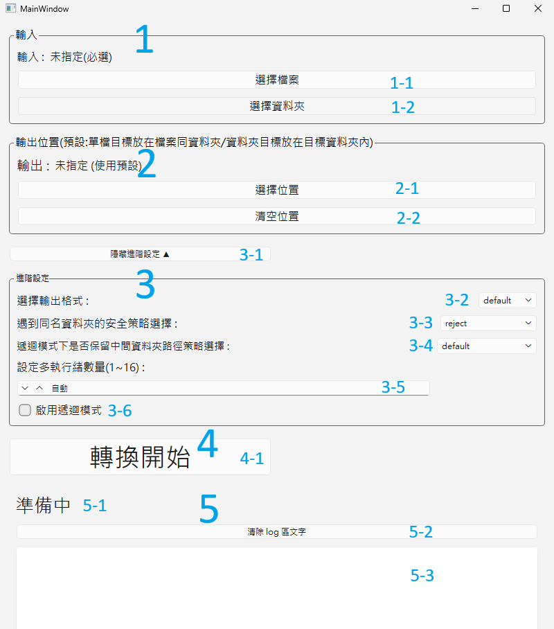

# RTF Converter - Windows 使用者手冊

## 目錄 | Table of Contents
- [1. 專案介紹 | Introduction](#1-專案介紹--introduction)
- [2. 系統需求 | System Requirements](#2-系統需求--system-requirements)
- [3. 下載與安裝 | Download and Installation](#3-下載與安裝--download-and-installation)
- [4. GUI 圖形化介面使用方式 | GUI Usage](#4-gui-圖形化介面使用方式--gui-usage)
- [5. CLI 命令列使用方式](#5-cli-命令列使用方式)
- [6. 輸出結果說明 | Output Formats](#6-輸出結果說明--output-formats)
- [7. 常見問題與錯誤排除 | Troubleshooting](#7-常見問題與錯誤排除--troubleshooting)
- [8. 版本資訊 | Version Information](#8-版本資訊--version-information)
- [9. 回報問題 | Bug Reports](#9-回報問題--bug-reports)

## 1. 專案介紹 | Introduction

RTF Converter 是一款用於將 RTF 文件轉換為其他文件格式的工具，提供圖形化介面（GUI）與命令列介面（CLI）。

RTF Converter is a tool designed to convert RTF documents into other file formats, providing both a Graphical User Interface (GUI) and a Command-Line Interface (CLI).

### 主要功能 | Features

- 將 RTF 文件轉換為 TXT、Markdown、HTML。
- 擷取 RTF 文件中嵌入的圖片。
- 支援表格與巢狀表格。
- 支援單一檔案與批次轉換。
- 支援多執行緒處理。

- Convert RTF documents into TXT, Markdown, and HTML formats.
- Extract embedded images from RTF documents.
- Support tables and nested tables.
- Support single-file and batch conversion.
- Support multithreaded processing.

## 2. 系統需求 | System Requirements

### 支援平台 | Supported Platform

- Windows x64
- 已測試環境 | Tested environment:
  - 測試作業系統：Windows 11 x64 (Tested OS: Windows 11 x64)
  - CPU 架構：x64 (CPU Architecture: x64)

### 執行環境需求 | Runtime Requirements

- GUI：所需的應用程式執行階段函式庫與 Qt 相依元件皆已包含於 bin 資料夾中，無須另外安裝 Qt Runtime。

- CLI：所需的應用程式執行階段 DLL 檔案皆已包含於 bin 資料夾中，無須額外安裝其他第三方執行函式庫。

- 使用預編譯版本不需要安裝 CMake、GCC 或 Qt 開發套件。

- GUI: The required application runtime libraries and Qt dependencies are included in the bin directory. No separate Qt Runtime installation is required.

- CLI: The required application runtime DLLs are included in the bin directory. No additional third-party runtime libraries need to be installed separately.

- CMake, GCC, and Qt development packages are not required when using the prebuilt release.

> 注意：本程式已於指定的 Windows 測試環境中完成測試。尚未測試的 Windows 版本不保證能正常執行。

> Note: The application has been tested on the specified Windows environment. Compatibility with untested Windows versions is not guaranteed.

## 3. 下載與安裝 | Download and Installation

### 3-1 下載 | Download

前往 GitHub Releases 頁面 | Visit the GitHub Releases page :

[RTF Converter Releases](https://github.com/suku156/rtf_convert/releases)

下載 Windows 預編譯版本 | Download the Windows prebuilt package:

`RTFConverter-Windows-x64.zip`

### 3-2 解壓縮 | Extract the Package

下載完成後，可使用 Windows 檔案總管解壓縮，或透過 CMD / PowerShell 執行下方指令。

After downloading, extract the package using Windows File Explorer, or run the following command in CMD / PowerShell.

```bash
tar -xf RTFConverter-Windows-x64.zip
```

解壓縮後的目錄結構如下：

The extracted directory structure should look like this:

```text
RTFConverter-Windows-x64/
└── bin/
    ├── rtfconvert_gui.exe
    ├── rtfconvert_cli.exe
    └── ... (runtime libraries and Qt dependencies)
```

## 4. GUI 圖形化介面使用方式 | GUI Usage

### 4-1 啟動程式 | Launch the Application

開啟解壓縮後的 bin 資料夾，找到 rtfconvert_gui.exe，直接雙擊即可啟動圖形化介面。

Open the extracted bin folder, locate rtfconvert_gui.exe, and double-click it to launch the graphical interface.

也可以透過 CMD / PowerShell 執行下方指令啟動：

Alternatively, launch the application using the following command in CMD / PowerShell:

```bash
.\RTFConverter-Windows-x64\bin\rtfconvert_gui.exe
```

### 4-2 介面功能說明 | Interface Overview



#### 4-2-1 輸入設定 (標記 1 區域) | Input Settings (Area 1)
|介面項目|Interface|功能說明|Description|
|---|---|---|---|
|1-1 選擇檔案|1-1 Select File|選擇單一 RTF 檔案作為轉換來源|Select a single RTF file for conversion.|
|1-2 選擇資料夾|1-2 Select Folder|選擇包含 RTF 檔案的資料夾，對資料夾內的 RTF 檔案進行批次轉換。|Select a folder containing RTF files for batch conversion.|

#### 4-2-2 輸出位置 (標記 2 區域) | Output Location (Area 2)
|介面項目|Interface|功能說明|Description|
|---|---|---|---|
|2-1 選擇位置|2-1 Select Location|指定轉換結果的輸出位置。|Specify the output location for converted files.|
|2-2 清空位置|2-2 Clear Location|清除目前設定的輸出位置，恢復使用預設輸出位置。|Clear the currently selected output location and revert to the default output location.|

- 預設輸出位置 | Default Output Location
  - 單一檔案轉換：輸出結果儲存在輸入 RTF 檔案所在的資料夾。
  - 資料夾批次轉換：輸出結果儲存在目標資料夾內。
  - Single-file conversion: Converted files are saved in the same directory as the input RTF file.
  - Folder batch conversion: Converted files are saved inside the target folder.

#### 4-2-3 進階設定（標記 3 區域）| Advanced Settings (Area 3)
|介面項目|Interface|功能說明|Description|
|---|---|---|---|
|3-1 進階設定展開／收合|3-1 Toggle Advanced Settings|展開或隱藏進階設定區域。|Expand or collapse the advanced settings section.|
|3-2 輸出格式|3-2 Output Format|選擇 TXT、Markdown 或 HTML 作為輸出格式（預設為 TXT）。|Select TXT, Markdown, or HTML as the output format (default: TXT).|
|3-3 同名檔案處理模式|3-3 Duplicate File Policy|設定輸出檔案名稱發生衝突時的處理方式。|Specify how to handle output filename conflicts.|
|3-4 遞迴路徑保留策略|3-4 Recursive Path Preservation Policy|設定遞迴轉換時，是否保留來源資料夾的中間路徑結構。|Configure whether to preserve intermediate directory structures during recursive conversion.|
|3-5 執行緒數量|3-5 Thread Count|設定轉換使用的執行緒數量（1∼16 或自動）。|Set the number of processing threads (1–16 or automatic).|
|3-6 遞迴模式|3-6 Recursive Mode|啟用後，搜尋目標資料夾內的子資料夾，以處理其中的 RTF 檔案。|When enabled, search subdirectories of the target folder for RTF files to process.|

##### 3-3 同名檔案處理模式 | Duplicate File Policy
| 設定值 | Value | 說明 | Description |
|---|---|---|---|
|安全模式|reject|遇到輸出檔案名稱衝突時，拒絕輸出該檔案，以避免覆蓋既有檔案。|When an output filename conflict occurs, the file is not written to avoid overwriting an existing file.|
|覆蓋模式|overwrite|遇到輸出檔案名稱衝突時，覆蓋原本已存在的檔案。|When an output filename conflict occurs, the existing file is overwritten.|
|建立額外檔案模式|renamewithsuffix|遇到輸出檔案名稱衝突時，自動在新檔案名稱後附加數字，以建立不同名稱的檔案。|When an output filename conflict occurs, a numeric suffix is automatically appended to the new filename to create a uniquely named file.|

##### 3-4 遞迴路徑保留策略 | Recursive Path Preservation Policy
| 設定值 | Value | 說明 | Description |
|---|---|---|---|
|保留中間路徑策略|preserve-structure|遞迴處理子資料夾時，輸出結果會保留來源資料夾的相對路徑結構。|When processing subdirectories recursively, the output preserves the relative directory structure of the source folders.|
|不保留中間路徑策略(預設模式)|flat-output(default)|遞迴處理子資料夾時，所有輸出結果都會直接儲存在指定的輸出位置，不保留來源資料夾的子目錄結構。|When processing subdirectories recursively, all output files are saved directly in the specified output location without preserving the source subdirectory structure.|

#### 4-2-4 轉換控制（標記 4 區域）| Conversion Control (Area 4)
|介面項目|Interface|功能說明|Description|
|---|---|---|---|
|4-1 轉換開始|4-1 Start Conversion|開始執行轉換工作。|Start the conversion process.|

#### 4-2-5 執行狀態與日誌（標記 5 區域）| Processing Status and Log (Area 5)
|介面項目|Interface|功能說明|Description|
|---|---|---|---|
|5-1 目前狀態|5-1 Current Status|顯示目前轉換階段或處理狀態。|Display the current conversion stage or processing status.|
|5-2 清除 Log|5-2 Clear Log|清除目前日誌區域中顯示的內容。|Clear the currently displayed log contents.|
|5-3 Log 顯示區|5-3 Log Display|顯示轉換過程中的訊息、處理進度及執行結果。|Display messages, processing progress, and conversion results.|

> 以上介面項目請依照實際發布版本的 GUI 確認與調整。

### 4-3 操作流程 | Conversion Workflow

1. 選擇輸入檔案或資料夾。
2. 指定輸出資料夾(若未指定，將使用預設輸出位置)。
3. 選擇輸出格式(預設格式為 TXT)。
4. 設定其他轉換選項。
5. 點擊 轉換開始 開始轉換。
6. 等待處理完成，並查看日誌及輸出資料夾。

1. Select an input file or folder.
2. Specify the output folder (if not specified, the default output location will be used).
3. Select the output format (the default format is TXT).
4. Configure additional conversion options.
5. Click the Start button to start the conversion.
6. Wait for the conversion to complete, then review the log and the results in the output folder.

## 5. CLI 命令列使用方式

### 5-1 啟動 CLI | CLI Usage

在 CMD / PowerShell 中執行以下命令以啟動 CLI：

Run the following command in CMD / PowerShell to launch the CLI:

```bash
.\RTFConverter-Windows-x64\bin\rtfconvert_cli.exe
```
或者，先切換至解壓縮後的套件目錄，再直接執行程式：

Alternatively, navigate to the extracted package directory and run the executable directly:

```bash
cd RTFConverter-Windows-x64\bin
.\rtfconvert_cli.exe
```

### 5-2 命令列參數 | Command-Line Arguments

CLI 支援以下命令列參數。--input 為必要參數，其餘參數可依需求選擇使用。

The CLI supports the following command-line arguments. The --input parameter is required; all other parameters are optional and can be used as needed.

#### 使用格式 | Usage

```bash
.\RTFConverter-Windows-x64\bin\rtfconvert_cli.exe --input <path> [--output <dir>] [--format txt] [options]
```
#### 參數說明 | Parameter Descriptions

|參數|Option|功能說明|Description|
|---|---|---|---|
|--input|Required|指定輸入的 RTF 檔案或資料夾。|Specify the input RTF file or folder.|
|--output|Optional|指定輸出資料夾。若未指定，單一檔案轉換時會輸出至輸入檔案所在資料夾；資料夾轉換時會輸出至目標資料夾。|Specify the output directory. If omitted, single-file conversion outputs to the input file's directory, while folder conversion outputs to the target folder.|
|--format|Optional|指定輸出格式。目前支援 txt、md 及 html，預設格式為 txt。|Specify the output format. Supported formats are txt, md, and html. The default format is txt.|
|--version|Optional|顯示目前程式的版本號。|Display the current application version.|
|--overwrite|Optional|遇到輸出檔案名稱衝突時，採取覆蓋策略。不可與 --reject 或 --renamewithsuffix 同時使用。|Use the overwrite policy when an output filename conflict occurs. Cannot be used with --reject or --renamewithsuffix.|
|--renamewithsuffix|Optional|遇到輸出檔案名稱衝突時，採取新增檔案策略，並在新檔案名稱後附加數字。不可與 --reject 或 --overwrite 同時使用。|Use the rename-with-suffix policy when an output filename conflict occurs. A numeric suffix is appended to the new filename. Cannot be used with --reject or --overwrite.|
|--reject|Optional|遇到輸出檔案名稱衝突時，採取安全策略，拒絕輸出衝突檔案。此為預設處理模式。不可與 --overwrite 或 --renamewithsuffix 同時使用。|Use the reject policy when an output filename conflict occurs. Conflicting files are not written. This is the default policy and cannot be used with --overwrite or --renamewithsuffix.|
|--recursive|Optional|當輸入目標為資料夾時，啟用遞迴處理，搜尋並處理其子資料夾中的 RTF 檔案。|Enable recursive processing when the input is a folder, allowing RTF files in its subdirectories to be processed.|
|--preserve-structure|Optional|在資料夾遞迴模式下，保留來源子資料夾的相對路徑結構。若未設定，則使用預設行為。不可與 --flat-output 同時使用。非資料夾遞迴模式下，此參數會被忽略。|Preserve the relative directory structure of source subdirectories during recursive folder processing. If omitted, the default behavior is used. Cannot be used with --flat-output. Ignored when recursive folder processing is not enabled.|
|--flat-output|Optional|在資料夾遞迴模式下，不保留來源子資料夾的相對路徑結構，將輸出檔案集中於輸出位置。若未設定，則使用預設行為。不可與 --preserve-structure 同時使用。非資料夾遞迴模式下，此參數會被忽略|Do not preserve the relative directory structure during recursive folder processing. Output files are placed directly in the output location. If omitted, the default behavior is used. Cannot be used with --preserve-structure. Ignored when recursive folder processing is not enabled.|
|--thread|Optional|指定遞迴模式下使用的執行緒數量。設定值必須為 1 至 16 的正整數。若指定的執行緒數量超過目標檔案數量，程式會自動調整。非遞迴模式下，此參數會被忽略。|Specify the number of threads used in recursive mode. The value must be a positive integer from 1 to 16. If the specified thread count exceeds the number of target files, it is automatically adjusted. Ignored in non-recursive mode.|
|--help|Optional|顯示命令列參數說明。|Display the command-line help information.|


### 5-3 路徑與檔名注意事項 | Paths and Filenames

Windows 路徑或檔名若包含空格，請使用雙引號包住：

If a Windows path or filename contains spaces, enclose it in double quotation marks.

```bash
--input "input files\sample.rtf"
```

例如：

For example:

```bash
.\rtfconvert_cli.exe --input "input files\sample.rtf"
```

## 6. 輸出結果說明 | Output Formats

### 支援格式 | Supported Formats

| 格式 | 說明 | Description |
|---|---|---|
| TXT | 純文字格式 |Plain text format.|
| Markdown | Markdown 文件格式 |Markdown document format.|
| HTML | 可使用瀏覽器開啟的網頁格式 |HTML format that can be viewed in a web browser.|

### 圖片擷取 | Image Extraction

- 轉換過程中擷取的圖片會儲存於輸出資料夾中的 images 子資料夾。圖片將依照其在原始文件中的處理順序，從 IMG_0 開始依序命名 , 當輸出格式為 HTML 時，若擷取的圖片格式受到支援，轉換器會嘗試在 HTML 成品中引用對應的圖片。

- During conversion, extracted images are saved in the images subdirectory within the output folder. Images are named sequentially, starting from IMG_0, according to their processing order in the original document.

- When the output format is HTML, the converter attempts to reference the corresponding extracted images in the generated HTML document if their formats are supported.

### 表格處理 | Table Processing

不同輸出格式對表格的呈現方式與支援程度有所差異。

The presentation and level of table support vary across output formats.

|格式|說明|Description|
|---|---|---|
|TXT|嘗試以文字重建原始表格架構，但無法完全還原原始表格的外觀與結構。目前不支援巢狀表格。|Attempts to reconstruct the original table structure using plain text. However, the original appearance and structure cannot be fully reproduced. Nested tables are currently not supported.|
|Markdown|使用 Markdown 所支援的表格格式呈現。Markdown 原則上不支援巢狀表格，因此無法呈現原始文件中的巢狀表格結構。|Renders tables using the table format supported by Markdown. Markdown generally does not support nested tables, so nested table structures from the original document cannot be represented.|
|HTML|能以較完整的方式呈現原始表格架構，並處理較複雜及精細的表格結構。支援巢狀表格呈現。|Provides a more complete representation of the original table structure and supports more complex and detailed tables, including nested table rendering.|

### 日誌資訊 | Log Information

程式會在轉換過程中記錄相關訊息，包括處理進度、轉換結果及可能發生的錯誤。相關日誌會以 log.txt 文件的形式儲存於輸出資料夾中。使用者可透過 GUI 的日誌顯示區或 log.txt 查看執行資訊，以了解轉換狀態或協助排除問題。

During the conversion process, the application records relevant information, including processing progress, conversion results, and potential errors. The log is saved as a log.txt file in the output directory. Users can review the execution information through the GUI log display area or the log.txt file to monitor the conversion status or assist in troubleshooting.

### 圖形資料處理限制 | Graphical Data Processing Limitations

目前程式尚未支援 RTF 文件中的圖形資料處理。轉換過程中，相關圖形內容可能會被略過，因此輸出文件不一定能完整呈現原始文件的圖形資訊。

The application currently does not support processing graphical data in RTF documents. Such content may be skipped during conversion, and the output document may not fully preserve the graphical information of the original document.

## 7. 常見問題與錯誤排除 | Troubleshooting

### 7-1 Windows 安全性警告 | Windows Security Warnings

若執行程式時出現 Windows 安全性警告，請確認程式來源是否為官方 GitHub Releases。

If a Windows security warning appears when launching the application, verify that the program was downloaded from the official GitHub Releases page.

### 7-2 Qt Runtime 或 DLL 錯誤 | Qt Runtime or DLL Errors

如果 GUI 無法啟動，或出現缺少 Qt Runtime、DLL 或平台外掛的錯誤，請確認程式所需的執行階段檔案是否完整。

If the GUI fails to start or reports missing Qt Runtime, DLL, or platform plugin errors, verify that all required runtime files are present.

請勿單獨移動或刪除 bin 資料夾中的 DLL 與 Qt 相關檔案。

Do not move or delete DLLs or Qt-related files from the bin directory.

### 7-3 程式無法啟動或出現缺少 DLL 的錯誤 | Missing DLL Errors

若程式無法啟動並提示缺少 DLL，請確認是否完整解壓縮發布套件，並檢查 bin 資料夾中的相依檔案是否存在。

If the application fails to start and reports missing DLL files, verify that the release package has been fully extracted and that the required dependency files are present in the bin directory.

### 7-4 檔案轉換失敗 | Conversion Failed

請先確認：
- 輸入檔案是否為有效的 RTF 文件。
- 輸入檔案是否能正常讀取。
- 輸出資料夾是否具有寫入權限。
- 日誌是否提供進一步的錯誤資訊。

Please check the following items first:
- Whether the input file is a valid RTF document.
- Whether the input file can be read successfully.
- Whether the output folder has write permissions.
- Whether the log provides additional error information.

## 8. 版本資訊 | Version Information

- 目前版本 | Current Version： v1.0.0
- 發布平台 | Release Platform： Windows x64
- 測試環境 | Tested Environment: Windows 11 Home (64-bit)

## 9. 回報問題 | Bug Reports

如果遇到程式錯誤或轉換結果異常，歡迎至 GitHub 專案頁面提交 Issue，並盡可能附上：

- Windows 版本與系統架構。
- 使用 GUI 或 CLI。
- 輸入檔案類型與相關操作步驟。
- 錯誤訊息或日誌。
- 預期結果與實際結果。

If you encounter application errors or unexpected conversion results, you are welcome to submit an Issue on the GitHub project page. Please include the following information whenever possible:

- Windows version and system architecture.
- Whether the GUI or CLI was used.
- Input file type and relevant operation steps.
- Error messages or logs.
- Expected results and actual results.